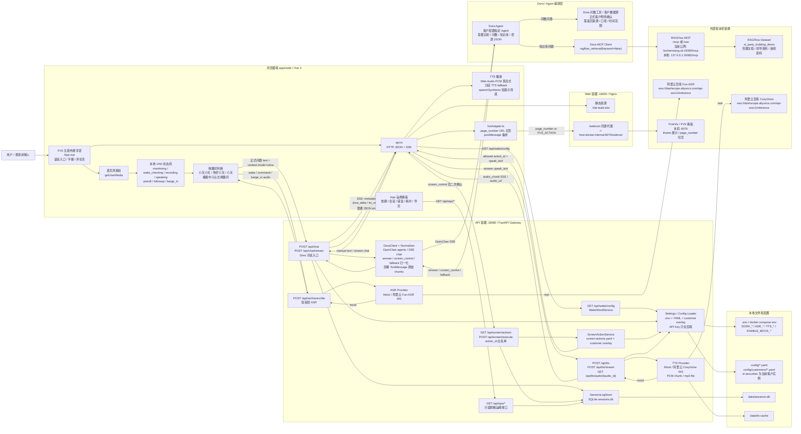
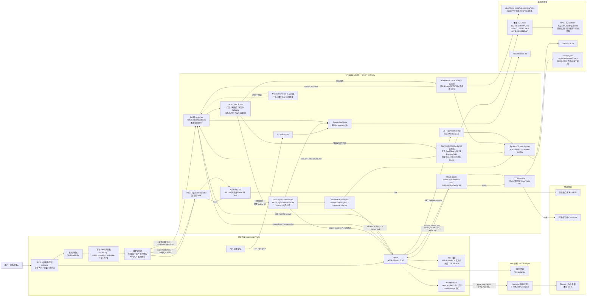

# 主链路系统架构图

> Lifecycle: `ARCHIVED_POC_SNAPSHOT`。本文是 2026-06-15 前后 POC 主链路设计快照，不代表最终 as-built 清单或多大屏标准产品目标。文中的“当前、尚未实现、推荐”均只表示快照当时状态，不能指导新开发。目标架构见 [17_STANDARD_PRODUCT_DESIGN.md](17_STANDARD_PRODUCT_DESIGN.md)。

本文只覆盖通用可配置数字人 POC 主链路。中天证券党建大屏是一个客户配置实例, 通过 `config/customers/zt-securities/` 实现, 不是核心代码的项目定位。临时宣传录屏链路已从主线清理, 不作为本架构图输入。

本文拆成两个版本:

- 版本 A: Dora 中心版。问数和知识库 MCP 都由 Dora Agent 承接, Gateway 只负责协议、安全、归一化、TTS 和控屏白名单。
- 版本 B: 本地直连版。问数和知识库都由 Gateway 本地 Adapter 直连处理, Dora 不在问数 / 知识库主路径上。

快照当时的代码状态:

- 版本 A 的知识库路径已实现: `Gateway -> Dora OpenClaw SSE -> RAGFlow MCP -> RAGFlow Dataset`。
- 版本 A 的问数路径可通过 `ASK_METRICS_MODE=dora` 进入 Dora, 但 Dora 侧真实问数工具 / 数据源仍需客户环境确认。
- 版本 B 的问数路径已实现: `Gateway -> AskMetrics Excel Adapter -> docs/demo_data/ask_metrics/*.xlsx`。
- 版本 B 的知识库直连路径在本快照时仍是目标架构；该状态后来已由阶段 3 实现记录取代，详见当前 [DEV_LOG.md](DEV_LOG.md) 所引用的历史日志。

## 版本 A: Dora 中心版

适用场景:

- 客户希望 Dora Agent 后台完整留痕。
- 问数和知识库统一由 Dora 编排。
- Gateway 保持轻量, 不直接理解知识库检索策略或真实问数数据源。

推荐配置:

```env
ENABLE_MOCK_DORA=false
ASK_METRICS_MODE=dora
DEMO_STABLE_MODE=false
```



### 版本 A 调用关系

1. 前端完成麦克风授权、本地 VAD、唤醒词判断和正式指令录音。
2. ASR 只经 Gateway 调用 Provider, 前端不直接访问语音供应商。
3. 正式问题进入 `/api/chat/stream` 或 `/api/chat`。
4. Gateway 不在本地拦截问数; 问数和知识库问题都发给 Dora。
5. Dora 对问数调用 Dora 侧数据工具; 对知识库调用 RAGFlow MCP `ragflow_retrieval(keyword=false)`。
6. Dora 输出统一 JSON 或自然语言, Gateway 归一化为 `answer`、`screen_control`、`fallback`。
7. `screen_control` 必须再走 `/api/screen/execute` 白名单确认。
8. TTS 由 Gateway 调用真实 / Mock Provider, 前端只播放后端返回的音频流或音频 URL。
9. 会话、控屏和错误写入 SQLite, `/ops` 只读查看。

## 版本 B: 本地直连版

适用场景:

- 客户希望固定演示稳定、低延迟、可离线兜底。
- 问数和知识库结果希望由本地 Gateway 明确控制来源、口径和检索参数。
- 不要求 Dora Agent 后台记录每条指标 / 知识库查询。

推荐配置:

```env
ASK_METRICS_MODE=excel
ENABLE_MOCK_DORA=true 或保留 Dora 仅作兜底
DEMO_STABLE_MODE=true 可用于现场演示稳态
```

本地知识库直连目标需新增:

```text
apps/api/app/services/knowledge_direct.py
```

该 Adapter 可选择直连:

- 本地 RAGFlow MCP: `http://127.0.0.1:19382/mcp`
- 或 RAGFlow Retrieval API: `http://127.0.0.1:19380/api/v1/retrieval`



### 版本 B 调用关系

1. 语音入口、VAD、ASR、TTS、FVS 控屏和 Ops 与版本 A 保持一致。
2. 正式问题进入 Gateway 后, 由本地 `Local Intent Router` 先做意图分类。
3. 指标问数走 `AskMetrics Excel Adapter`, 直接读取脱敏 Excel, 返回固定口径和来源。
4. 知识库问答走目标态 `KnowledgeDirectAdapter`, 由 Gateway 直接调用本机 RAGFlow MCP 或 Retrieval API。
5. Dora 不参与问数和知识库主路径; 可保留 Mock Dora / Dora 作为未命中兜底, 但不作为数据来源。
6. 控屏仍必须使用固定 `action_id` 并经过 `/api/screen/execute` 后端白名单校验。
7. 所有回答仍走后端 TTS Provider, 前端不直接访问供应商。

## 两版关键差异

| 维度 | 版本 A: Dora 中心版 | 版本 B: 本地直连版 |
| --- | --- | --- |
| 问数入口 | Gateway 转发给 Dora | Gateway 本地 `AskMetrics Excel Adapter` |
| 知识库入口 | Dora 调用 RAGFlow MCP | Gateway 直连 RAGFlow MCP / Retrieval API |
| Agent 后台留痕 | Dora 可记录问数和知识库问题 | Dora 不记录本地直连问题 |
| 延迟 | 取决于 Dora 推理 + MCP 工具调用 | 更可控, 少一层 Agent 编排 |
| 答案稳定性 | 依赖 Dora Prompt 和工具输出稳定性 | Gateway 可固定口径、阈值、来源展示 |
| 灵活性 | Dora 可统一编排复杂问答 | 需要本地实现意图路由和知识库答案生成 |
| 当前实现 | 知识库已实现, 问数需 Dora 侧数据工具确认 | Excel 问数已实现, 知识库直连 Adapter 未实现 |
| 风险 | Dora 输出格式和工具结果转回答不稳定 | Gateway 需承担检索、摘要和引用组织逻辑 |

## 共同安全边界

- 前端不保存、不读取、不透传 Dora / ASR / TTS API Key。
- 大屏控制只能使用 `action_id`; 不执行模型生成 JavaScript。
- 控屏必须经 `/api/screen/execute` 后端白名单校验后, 前端才驱动 FVS。
- 本地 Excel 问数只读, 不执行模型生成 SQL、Python、JavaScript 或 shell。
- Mock 开关必须保留: `ENABLE_MOCK_DORA`、`ENABLE_MOCK_ASR`、`ENABLE_MOCK_TTS`、`ENABLE_MOCK_FVS`。
- 客户差异通过 `config/customers/<customer-id>/` 覆盖默认 YAML, `.env` 只放密钥、本机端口和显式运行时开关。当前中天证券实例使用 `config/customers/zt-securities/`。
- FVS 主线为数字人前端 iframe host 模式; 本机 `X-Frame-Options: SAMEORIGIN` 通过 Web Nginx `/webroot` 同源代理解决。
