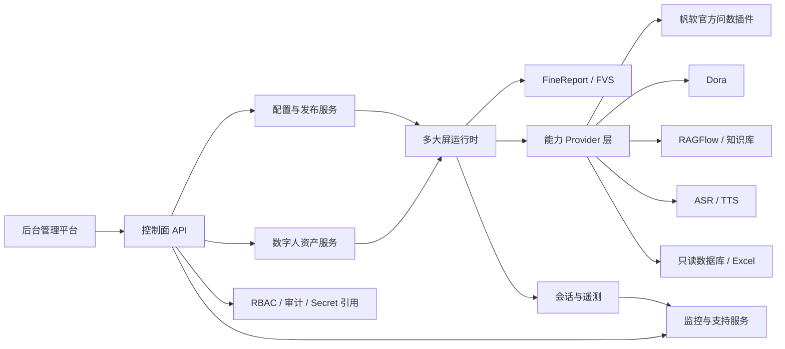

# FineReport / FVS 多大屏数字人产品设计

## 文档状态

- 状态: 产品化目标设计，尚未实现
- Lifecycle: `TARGET_NOT_IMPLEMENTED`
- 日期: 2026-07-26
- 工作名称: FVS 数字人交互运营平台
- 现有基础: V1.0 POC、能力 Provider 抽象、配置覆盖层、受控控屏与只读运维能力

本文档描述产品目标态，不代表当前代码已经支持多大屏、2D / 3D 形象热插拔、RBAC、官方插件问数或完整后台管理。

## 1. 一句话定位

面向已经合法采购 FineReport、并使用 FVS 建设大屏的客户，提供一套本地化部署的多大屏对话数字人管理平台；复用客户既有 FVS 大屏和数据权限，在不重做报表与大屏的前提下，统一配置数字人形象、语音、问数、知识库、控屏、发布和运维能力。

## 2. 目标客户与产品边界

### 2.1 理想客户

客户必须同时满足:

- 已采购并部署受支持版本的 FineReport。
- 已使用 FVS 建设至少一块业务大屏。
- 希望在既有大屏上增加数字人讲解、语音问答、问数或控屏能力。
- 接受本地化或私有网络部署，并能提供 FineReport / FVS 管理员和业务口径负责人参与实施。

优先场景:

- 展厅、指挥中心、经营驾驶舱、主题展厅、生产看板、营销看板。
- 同一客户在一个站点存在多个大屏，希望统一配置、发布和运维。
- 已有 FineReport 数据权限和模板资产，不希望另建一套 BI 或大屏系统。

产品目标覆盖 FineReport / FVS `11.0` 大版本及之后版本。这里的“覆盖”是产品适配目标，不等于所有未来版本天然兼容；交付时仍以“FineReport 精确版本 + FVS 精确版本 + 官方插件精确版本 + 本产品版本”的已验证兼容矩阵为准。未进入兼容矩阵的组合可以做适配验证，但不能直接标记为产品已认证。

### 2.2 明确不做

- 不做面向任意网页或任意 BI 产品的通用数字人 SaaS。
- 不替代 FineReport 报表设计器、FVS 大屏设计器或客户业务数据仓库。
- 不承诺无需 FineReport / FVS 即可独立运行生产大屏。
- 不让模型生成并执行任意 SQL、Python、JavaScript 或 shell。
- 不让前端绕过后端白名单直接执行 FVS 动作。
- 不把任意可执行脚本当作“数字人形象包”上传。
- 不在产品 V1 直接建设跨客户共享数据的公有云多租户平台。

### 2.3 部署边界

产品 V1 采用“单客户物理隔离、多环境、单站点、多大屏”:

```text
客户 Tenant
└─ 部署环境 Deployment（开发 / 测试 / 生产）
   └─ 站点 Site
      └─ 大屏组 Screen Group
         └─ 大屏实例 Screen Instance
            └─ 数字人部署实例 DigitalHumanInstance
```

每个客户独立部署控制面、运行时和数据存储。领域模型保留 `tenant_id`，但不以跨客户共享数据库作为 V1 交付前提。

标准交付默认创建一个 Site；领域模型保留 Site 层级，避免未来扩展多站点时重构 ScreenInstance。产品不按许可证硬编码大屏数或并发会话数上限，当前阶段只要求支持多路并发和实例隔离，不承诺高并发优化、线性扩容或“无限并发”性能。

## 3. 产品设计原则

### 3.1 复用客户已有资产

- FVS 继续负责大屏布局和业务可视化。
- FineReport 继续负责报表、数据权限和既有模板资产。
- 本产品只增加数字人交互、能力编排、配置发布和统一运维。

### 3.2 配置优先

- 新增一块大屏、新形象或新供应商时，优先通过后台配置完成。
- 客户化内容放在客户解决方案配置中，不 fork 核心代码。
- 常用配置使用向导和预设，低频技术参数放入高级设置。
- 配置必须可校验、可预览、可比较、可发布、可回滚。

### 3.3 能力可选，但依赖关系必须明确

- Dora、知识库、直连 LLM、ASR、TTS 均可独立启用或关闭。
- 关闭 ASR 后仍可使用文本输入；关闭 TTS 后仍可显示文字。
- 关闭 Dora 后可使用本地规则、官方插件问数或受控直连能力。
- 每种组合在保存和发布前都必须经过依赖校验，不能让用户在运行时才发现配置不可用。

### 3.4 安全默认

- 密钥只保存在后端 Secret Store 或环境注入中，配置正文只保存 `secret_ref`。
- 控屏始终使用 `action_id`，后端完成白名单和参数 schema 校验。
- 数据库问数只允许只读账号、受控数据集、参数化查询、超时和结果行数限制。
- 数字人资产包不能携带任意可执行代码。
- 设备身份由注册凭据反查，不信任浏览器自行提交的客户或大屏标识。
- 后台用户身份、大屏设备身份和大屏绑定的 FineReport 数据身份相互独立，不用一个管理员 Token 代替三类身份。

### 3.5 面向交付与排障

- 用户随时可以看到当前生效配置、来源、版本和健康状态。
- 每个外部连接都提供“测试连接”和明确的失败建议。
- 每次发布都生成不可变快照、审计记录和一键回滚点。
- 监控按站点、大屏、会话和 Provider 归因，不只显示一个全局健康灯。

## 4. 用户与核心任务

| 角色 | 核心任务 | 产品应提供的最短路径 |
| --- | --- | --- |
| 平台管理员 | 安装、账号、权限、连接、备份、升级 | 系统预检、连接测试、RBAC、审计、备份恢复 |
| 实施工程师 | 注册大屏、绑定 FVS、配置数字人与能力、发布 | 建屏向导、配置预设、联调诊断、灰度发布 |
| 业务运营人员 | 调整人设、欢迎语、知识、问数口径、演示流程 | 业务化表单、预览、审批、定时发布 |
| 运维人员 | 看在线率、告警、错误、延迟和支持日志 | 运维中心、告警归因、脱敏支持包 |
| 审计 / 安全人员 | 查看权限、操作记录、数据访问和发布记录 | 只读审计、导出、留存策略 |

产品的首要任务不是让用户理解 Dora、RAGFlow 或模型参数，而是让用户完成:

```text
初始化默认站点（首次安装）
-> 注册大屏
-> 绑定 FVS
-> 选择数字人
-> 选择能力套餐
-> 测试连接
-> 预览
-> 发布
-> 监控
```

## 5. 核心领域模型

### 5.1 组织与运行对象

| 对象 | 作用 |
| --- | --- |
| Tenant | 客户安全边界；V1 中通常对应一套独立部署 |
| Deployment | 开发、测试或生产环境 |
| Site | 一个展厅、办公区、工厂或业务地点 |
| ScreenGroup | 共享默认配置或批量发布策略的一组大屏 |
| ScreenInstance | 一块实际运行的大屏，包含设备状态与 FVS 绑定 |
| DeviceEnrollment / DeviceCredentialFamily | 大屏首次注册、设备凭据族、强 ETag、代际和整族吊销状态 |
| DigitalHumanInstance | 部署在一块大屏上的数字人运行单元，也是配置、会话和监控的最小隔离单元 |
| RuntimeBinding | 某块大屏当前绑定的数字人、能力、动作和发布版本 |

### 5.2 可复用资产

| 对象 | 作用 |
| --- | --- |
| DigitalHumanProfile | 名称、人设、欢迎语、唤醒和交互策略 |
| AvatarPackage | 版本化渲染资产及兼容信息；未来经认证的 2D / 3D Adapter 复用同一契约 |
| VoiceProfile | ASR 热词、TTS 音色、语速、音量和打断策略 |
| CapabilityProfile | Dora、LLM、问数、知识库、ASR、TTS、控屏的组合策略 |
| ConnectorInstance | FineReport、Dora、RAGFlow、LLM、ASR、TTS 等连接配置 |
| QuerySource | 官方插件、数据库或 Excel 问数数据源 |
| KnowledgeBinding | 知识库、检索范围、来源规则和回答策略 |
| ScreenActionPack | `action_id`、参数 schema、FVS 路由和播报文案 |
| ConfigRelease | 一次可发布、可回滚的完整配置快照 |

一个资产可以被多块大屏复用，但 DigitalHumanInstance 绑定的必须是明确版本。产品 V1 默认每块大屏同一时刻只有一个活动 DigitalHumanInstance；可以预先配置多个候选实例，通过日程或场景切换活动绑定，不在同一画面并发运行多个数字人。

## 6. 配置与发布模型

### 6.1 固定继承层级

```text
产品默认
-> 客户
-> 环境 / 站点
-> 大屏组
-> 大屏实例
-> 紧急运行覆盖
```

设计约束:

- 不允许用户创建任意深度的继承树。
- 标量字段遵循“最近层覆盖”。
- 列表默认整体替换；只有标记为 `merge_by_id` 的列表可以按 ID 合并。
- `inherit` 表示继续使用上层值，`disabled` 表示明确关闭，二者不能混用。
- 管理平台必须显示“最终生效值、来源层级、配置版本、与上次发布的差异”。
- 紧急覆盖有有效期，到期自动回到正式发布版本。

### 6.2 生命周期

```text
Draft
-> Validated
-> Previewed
-> Approved
-> Published / Canary
-> Retired
```

- 发布版本不可原地修改。
- 回滚生成新的发布记录，不静默覆盖历史。
- 支持按单屏、大屏组、站点进行灰度。
- 发布前执行 schema、依赖、连接、权限、资源和控屏白名单校验。
- 大屏离线时保留最近一个已验证版本；重新上线后按策略拉取新版本。
- 创建 ConfigDraft 只提交目标 envelope 和 `schema_version`，服务端生成 empty spec；初始 spec 被拒绝，首次内容必须通过字段级授权的替换操作。

### 6.3 配置分层体验

“高可配置”不等于把所有底层参数堆给用户。后台采用三层体验:

| 层级 | 面向用户 | 内容 |
| --- | --- | --- |
| 业务配置 | 业务运营 | 人设、欢迎语、业务问法、知识范围、指标口径、形象、音色和发布日程 |
| 能力配置 | 实施工程师 | Provider 选择、连接绑定、模型 / 数据集、fallback、超时和大屏动作 |
| 系统配置 | 平台管理员 | 身份、Secret、存储、网络、备份、升级、许可证和容量 |

默认页面只显示完成任务所需字段；“推荐值”随产品版本维护。模型 Prompt 可以作为版本化、可审计的受控模板资产管理，但不能包含或触发任意可执行代码，也不能绕过问数、权限和控屏边界。

### 6.4 配置与产品扩展的边界

- 换大屏、换形象资产、换音色、换连接、换模型、换知识库、换问数 Provider、调整白名单动作，属于配置。
- 新增一个已经符合标准 Provider SPI 的供应商实现，属于受审计连接器扩展。
- 新增渲染引擎、执行协议或系统权限，属于产品版本升级。
- 上传任意脚本、自由 SQL 或动态执行模型输出，不属于可配置能力。

## 7. 目标架构



### 7.1 控制面

负责用户、权限、站点、大屏、资产、连接、配置、发布、审计、监控和升级。

V1 默认提供内置轻量数据库，优先满足单站点、多屏、低到中等并发的开箱部署；同时预留 ExternalControlPlaneStore / 迁移能力。P1.0 候选契约选择发布版本固定的 SQLite 3 作为内置引擎、PostgreSQL 16 作为唯一外置控制面存储；在 P1.0 用户验收和后续真实迁移证据前，这些仍是未实现、未认证的目标设计。

P1.0 候选契约将默认备份冻结为与活动数据目录分离的加密文件系统包，每小时执行并保留 24 个小时、7 个日、4 个周恢复点；生产恢复还要求独立于活动库、备份和账本本身的单调安全锚点，用认证追加 RecoverySecurityLedger 防止旧备份复活 bootstrap/production mode、已禁用用户、已移除角色/资源范围、旧密码/设备代际、已撤销 Secret/FineReport 或旧 key registry。闭合的 operation→ledger 映射覆盖 bootstrap；production activation/readiness/emergency authority reduction/crypto-root recovery；human operator identity/user binding；用户/密码/角色；设备；Secret；FineReport；key rotation/revoke。每个 DeviceCredentialFamily 最多一个 `ACTIVE` DeviceCredential。账本 `user_identity_snapshot` 不含 credential material；身份冲突时 ONLINE 保留旧库，FULL_LOSS 保持 staged UNSERVED。Secret/FineReport `RETIRING` 前任必须保存 canonical sorted exact target set 与 hash，否则 deny-all。

密钥管理固定十八个不可复用的 purpose domain；除请求、continuity、ledger、session/token/device、Secret、backup、offline recovery 等域外，CSRF verifier、human-operator attestation signature、disaster nonce、operational fence、production-readiness nonce、emergency-reduction nonce 都使用独立域。权威 key registry 位于外部 keystore/单调锚点；所有 keyed verifier 使用至少 256-bit key 的 HMAC-SHA-256 并保存 key ID，AES-256-GCM 记录保证每 key nonce 唯一并保存 nonce/tag/key ID/严格 AAD。不可变证据按 purpose 轮换而不重写；临时 KMS 故障返回 503 且状态不变，只有确认 revoke/loss 才不可逆失效。

恢复同时冻结 recovery-source 与 authorization 两个受约束维度：NORMAL 四眼必为 ONLINE；FULL_LOSS 必为 LOCAL 灾难 quorum；LOCAL+ONLINE 仅用于无可认证管理员。ONLINE 才捕获 live audit head、启用 barrier、携带完整 SecurityAuditSuffix 并保留旧 pointer；FULL_LOSS 的 previous pointer 为 null，suffix 严格为空且 backup head 等于 barrier head，恢复期采用从 backup-manifest audit head 起链、每条维持相同 2-of-3 Ed25519 quorum 的 ExternalRecoveryAudit，首条 staged audit 同时绑定 backup head 与该外部链 terminal hash。ContinuityEnvelope 以独立 HMAC key、nonce 和 prepared sequence 认证并与 CutoverRecord 一起绑定 source/authorization/admin-readiness 分支及严格 nullability；恢复删除所有 one-time response replay ciphertext。三屏与适用分支检查均在 pointer 前完成；生产外部服务还必须等待 ledger/nonce anchors、finalization、complete readiness 与匹配 READY fence。缺失 Secret/FineReport 材料的 exact set 由 NORMAL HighRiskAction 或 LOCAL envelope 二选一授权 degraded completion。

首次 BootstrapGrant 由本地 setup ceremony 预先绑定 server-reserved user、2-of-3 custodian-attested person/user binding、target channel/possession proof 与 registry generations，客户端不能替换这些身份。deployment 仍为 `SETUP`，可暂时只有一名管理员；仅 platform-admin 的 `deployment.manage`、`production_four_eyes_v1`、两名绑定不同有效 person 的可用管理员和完整灾备 readiness 才能单向激活 `PRODUCTION_ACTIVE`。生产 posture 由外部单调 OperationalFenceRecord 决定；临时依赖故障只形成 ephemeral fail-closed 503 gate，确认丢失/持久 breach 才追加 `RECOVERY_REQUIRED`。readiness recovery、emergency authority reduction、crypto-root recovery 都仅本地可用并有独立 authorization/terminal nonce/external audit；只有 readiness 分支可追加 READY successor。

RecoveryPasswordSetupGrant 是 NORMAL restore、LOCAL disaster、production-readiness replacement 共享的 authority-transition primitive：NORMAL 按缺失/陈旧 selected-admin credential 精确发 1..2 张，LOCAL disaster 在 SETUP 发 1 张、production 发 2 张，readiness replacement 发 1 张。状态为 `ISSUED -> PROVISIONALLY_CONSUMED -> COMMITTED_CONSUMED`，终态 `EXPIRED | ABORTED_REVOKED`；整组必须随匹配分支 anchor 原子提交或销毁全部 provisional verifier 并终结 nonce。

### 7.2 运行面

每个大屏运行时通过设备凭据获取:

- `tenant_id`
- `deployment_id`
- `site_id`
- `screen_id`
- `digital_human_instance_id`
- 当前 `config_release_id`
- 已授权的 FVS、数字人、能力和动作绑定

运行请求必须携带可信的 `screen_id` / `digital_human_instance_id` 上下文，按实例解析 Provider，不能继续依赖一个全局 `Settings` 单例为所有大屏提供相同配置。

### 7.3 Provider 层

核心业务只依赖标准能力接口，供应商实现作为可替换 Provider。每个 Provider 必须声明:

- 配置 schema 和 Secret schema。
- 支持版本和兼容约束。
- 健康检查与能力探测。
- 超时、重试、熔断、限流和 fallback。
- 标准错误码、指标和审计字段。
- 是否支持流式、会话、权限透传和取消。

“暂不做高并发优化”不取消多路并发的正确性要求。Provider 实现仍需具备异步调用或非阻塞边界、连接池、超时、取消、背压和按 Provider 的并发保护，避免一块大屏的慢请求阻塞其他大屏。

## 8. 能力配置

### 8.1 CapabilityProfile

| 能力 | 可选 Provider | 关闭后的行为 |
| --- | --- | --- |
| 对话编排 | 本地规则、Dora、受控直连 LLM | 仅保留明确配置的固定能力 |
| 问数 | FineReport 官方插件、只读数据库、Excel、Dora | 返回“当前大屏未开通问数” |
| 知识库 | Dora -> RAGFlow、Gateway 直连 RAGFlow、其他受控检索器 | 不路由知识问答 |
| LLM | Dora 内部模型、后台直连 Provider、无 | 使用模板 / 提取式回答或安全 fallback |
| ASR | Mock、供应商 Provider、无 | 保留文本输入 |
| TTS | Mock、供应商 Provider、浏览器降级、无 | 保留文字与字幕 |
| 数字人渲染 | 2D、3D、无形象语音模式 | 保留大屏与文本交互 |
| FVS 控制 | URL `page_number`、受控 `postMessage`、后续官方接口 | 只回答，不控屏 |

生产 ScreenInstance 必须绑定一个受支持的 FineReport / FVS 实例和目标大屏；可关闭的是“语音控屏能力”，不是产品对 FVS 的依赖。Mock FVS 只用于开发、预览和故障演练。

每项能力都使用 `enabled`、`primary_provider`、`fallback_providers` 等显式语义。`disabled` 与 `mock` 必须分开: Mock Dora / ASR / TTS / FVS 继续保留，但只作为开发、预览、培训和故障演练 Provider，不能再用一个全局 Mock 开关代替所有大屏的启停状态。

### 8.2 面向用户的能力套餐

后台默认提供少量可理解的预设:

- 基础讲解: 数字人 + 固定话术 + FVS 控屏。
- 语音助手: 基础讲解 + ASR + TTS。
- 知识助手: 语音助手 + 知识库。
- 问数助手: 语音助手 + FineReport 官方问数。
- 综合助手: 问数 + 知识库 + 控屏 + 可选 Dora / LLM。

用户可以复制预设形成自定义 CapabilityProfile，但不应被迫逐项理解底层供应商协议。

### 8.3 依赖校验示例

- 开启语音唤醒必须存在 ASR Provider 和麦克风权限策略。
- 开启 TTS 流式必须存在支持的音频格式与前端播放器。
- 开启直连知识库生成回答时，必须配置检索器；无 LLM 时只能使用来源约束的提取式回答。
- 开启官方插件问数时，必须通过插件版本、授权、认证、模板权限和能力探测。
- 开启控屏时，必须绑定 ScreenActionPack，且所有动作通过后端白名单验证。

## 9. FVS 问数产品方案

### 9.1 Provider 优先级

面向目标客户，默认推荐顺序:

```text
FineReportAiPluginAskProvider
-> DatabaseReadonlyAskProvider
-> ExcelAskProvider
-> 安全 fallback
```

具体顺序由 CapabilityProfile 配置，不强制所有客户使用同一链路。

自动降级只允许发生在技术不可达或当前能力明确不支持，且备用 Provider 的权限和数据范围与当前 ScreenInstance 绑定的数据身份和授权范围等价时。`permission_denied`、非法参数或无授权模板必须直接返回安全错误，不得降级到权限更高的数据库或 Excel。

### 9.2 统一问数输出

无论数据来自官方插件、数据库、Excel 还是 Dora，都归一化为:

- 回答文本与可播报文本。
- 指标或结果数据。
- 模板 / 报表 / 数据源标识。
- 参数、筛选条件和时间范围。
- 指标口径与数据更新时间。
- 权限上下文和数据范围。
- Provider、耗时、缓存和审计信息。
- 可选图表或跳转建议。

### 9.3 数据库与 Excel 的保留方式

- Excel 用于离线、小数据量、演示或官方插件不可用时的受控场景。
- 首批 DatabaseReadonlyAskProvider 连接器范围为 MySQL、Oracle 和 PostgreSQL；精确数据库版本和驱动组合按兼容矩阵认证。
- 数据库 Provider 只开放管理员预定义的数据集和参数化查询模板。
- 模型和普通运营用户不得提交自由 SQL。
- 数据库账号必须只读，配置表 / 字段白名单、超时、最大行数和审计。
- 查询结果在进入 LLM 前执行字段脱敏和最小化。

### 9.4 官方插件

仓库中的 `fine-plugin-com.fr.plugin.decision.ai.v11-1.2.5-202606151853.zip` 的 `plugin.xml` 将其声明为 FineReport 11 的“FR智能检索问答”插件，并描述了模板检索、参数化数据问答、多轮问答、推荐提问和数据解读相关能力。

当前尚未确认稳定外部 API、认证协议、会话、权限继承和升级稳定性。因此产品中先定义稳定的复合连接器 `FineReportAiConnector`，其问数实现为 `FineReportAiPluginAskProvider`，通过兼容性探测接入，不直接耦合插件内部路径。详细设计见 [integrations/FINEREPORT_AI_PLUGIN_INTEGRATION.md](integrations/FINEREPORT_AI_PLUGIN_INTEGRATION.md)。

官方插件由客户安装到自己的 FineReport 工程并负责合法授权，本产品只调用其经确认的外部能力，不复制、不内置、也不随产品分发插件包。当前样本 `1.2.5` 的 manifest 仅声明 `11.0~11.0`；FineReport / FVS 11.0 之后版本必须使用对应官方插件版本逐组合验证，不能根据产品目标范围推导该插件向前兼容。

大屏访客不登录本产品后台，因此运行时不能假设存在访客个人 FineReport 身份。每个 ScreenInstance 应绑定一个最小权限的 FineReport 展示 / 服务身份或受控会话策略；官方插件、数据库和 Excel fallback 都只能访问该大屏授权的数据集。插件返回权限拒绝时不得降级到权限更高的数据源。

该连接器是复合能力: 一部分负责授权模板检索和元数据发现，一部分负责参数化数据问答与会话；它不是 Dora、通用知识库或任意 LLM 的替代品。运行时问数仍通过统一 Provider 结果进入产品主链路。

## 10. 2D / 3D 数字人热插拔

当前没有可交付的 2D / 3D 资产、供应商或授权资源，因此首批产品不承诺任何具体形象格式。V1 先预留 `AvatarRendererProvider`、AvatarPackage manifest、状态事件、口型事件、资源加载和切换接口，并继续使用现有语音球 / 无形象模式作为默认 Renderer。真正的 2D / 3D 支持在取得合法资产和供应商 SDK 后，以独立 Renderer Adapter 接入。

### 10.1 热插拔定义

“热插拔”指在不重编译前端、不重启后端的情况下，把某块大屏绑定的 AvatarPackage 从一个已验证版本切换到另一个版本，并支持客户端预取、原子切换和一键回滚。

它不包括:

- 上传并执行任意 JavaScript。
- 在线安装未经审计的新渲染引擎。
- 绕过许可证或资产版权校验。

### 10.2 AvatarPackage

形象包 manifest 至少包含:

- `avatar_id`、`version`、`display_name`。
- `avatar_type`: `2d` 或 `3d`。
- `renderer_type` 与 `renderer_version_range`。
- 入口资产、资源清单、SHA-256。
- `idle`、`listening`、`thinking`、`speaking`、`error` 状态映射。
- 口型模式: 音量驱动、viseme 或渲染器专用映射。
- 最低浏览器、GPU、显存和内存要求。
- 画布比例、透明背景和安全区域。
- 许可证、版权方、有效期和使用范围。

`avatar_type=test` 只用于 P3 的内置声明式测试 Renderer，始终标记为
`TEST_ONLY` 且不可作为生产形象。它验证接口、预取、按屏切换和回滚，
不扩大上述真实形象类型与格式承诺。

支持格式按已验证 Renderer Adapter 的兼容矩阵开放。透明视频、序列帧、Live2D / Spine、glTF / GLB / VRM 等仅是未来候选，不属于 V1 已承诺格式。具体格式必须经过渲染器、浏览器、显卡和授权验证后才标记为“产品支持”。

### 10.3 发布流程

```text
上传
-> 病毒 / 文件类型 / manifest 校验
-> 许可证与兼容性检查
-> 管理端预览
-> 目标大屏资源预取
-> 灰度发布
-> 对话边界原子切换
-> 监控
-> 回滚
```

运行中切换失败时继续使用旧版本，不让大屏进入空白状态。新渲染引擎本身属于产品升级，不属于普通资产热插拔。

## 11. 后台管理平台

当前 `/ops` 和 `/ops/config` 应演进为统一控制面，而不是在旧监控页不断堆叠入口。

### 11.1 信息架构

| 一级模块 | 主要内容 |
| --- | --- |
| 总览 | 站点、大屏在线率、告警、发布状态、Provider 健康 |
| 大屏管理 | 站点、大屏组、设备注册、FVS 绑定、运行预览、批量操作 |
| 数字人中心 | 人设、Renderer / AvatarPackage 扩展资产、音色、预览、版本和安全切换 |
| FineReport / FVS | 实例连接、模板资源、官方插件状态、动作包、权限与兼容性 |
| 能力与连接 | Dora、LLM、RAGFlow、ASR、TTS、官方问数、数据库、Excel |
| 数据与知识 | 问数数据源、指标口径、知识库、来源质量和更新状态 |
| 交互体验 | 唤醒词、连续对话、打断、欢迎语、fallback、延迟策略 |
| 发布中心 | 草稿、校验、预览、审批、灰度、发布、差异和回滚 |
| 运维中心 | 在线状态、会话、错误、延迟、用量、告警和脱敏支持包 |
| 安全与系统 | 用户、角色、审计、Secret 引用、留存、许可证、备份和升级 |

### 11.2 大屏配置向导

1. 使用安装时自动创建的默认站点，选择或新建大屏组。
2. 注册设备或生成一次性注册令牌。
3. 选择 FineReport / FVS 连接和目标模板。
4. 测试嵌入、权限和基础跳转。
5. 选择数字人人设、AvatarPackage 和 VoiceProfile。
6. 选择能力套餐，按需调整 Provider 和 fallback。
7. 绑定问数数据源、知识库和 ScreenActionPack。
8. 执行依赖、权限、性能和安全预检。
9. 在预览环境完成文本、语音、问数、知识和控屏测试。
10. 灰度发布并观察，随后正式发布。

### 11.3 RBAC

V1 使用产品自带的用户与权限管理，不接 AD、LDAP 或 OIDC。内置身份系统至少包含本地账号、密码安全存储、登录失败锁定、会话过期、管理员重置、角色授权和操作审计；未来如增加企业身份源，只能作为可选 IdentityProvider Adapter，不改变本地 RBAC 权限模型。

浏览器会话使用 host-only `__Host-shuziren_session`（Secure/HttpOnly/SameSite=Strict/Path=/、无 Domain）；重复或歧义 cookie 拒绝认证。所有浏览器状态变更（含未登录 login）检查 exact Origin allowlist；cookie mutation 要求 session-bound CSRF header，唯一例外是仍要求 exact Origin/no-store 的 `refreshCsrfToken`。服务端仅存独立 `CSRF_TOKEN_VERIFIER_PEPPER` 下的 HMAC verifier/key ID；`getCurrentAuthSession` 只读且绝不轮换 CSRF。认证、重认证和权限变化会轮换 session identifier，并在新 cookie 可用前原子吊销旧 verifier。

后台用户用于配置、发布和运维，大屏设备通过 DeviceEnrollment 认证，FineReport 数据访问使用 ScreenInstance 绑定的展示 / 服务身份，三者不能混用。

产品至少提供:

- 平台管理员: 系统、用户、连接、Secret 引用、备份升级。
- 实施工程师: 站点、大屏、能力、资产和发布。
- 业务运营: 人设、话术、知识、指标口径和预览，不可查看 Secret。
- 运维人员: 监控、告警、日志和受控重试。
- 审计只读: 查看配置版本、权限、操作和数据访问记录。

高风险操作需要原因、二次确认和审计；production activation、发布、设备 enrollment、Secret/FineReport、设备整族吊销、回滚和恢复采用四眼。HighRiskAction 使用独立 `request_hmac_key_id`，一般敏感 idempotency 使用 `sensitive_digest_key_id`。重提 reauth 过期返回 HTTP 403 `RECENT_REAUTHENTICATION_REQUIRED`，action 在 TTL 内仍 `APPROVED`。异步网络执行的 ImmutableTypedCommand、Idempotency、Operation、Outbox 与 audit 统一绑定 `authorization_kind` 和 exactly one DirectOperationAuthorization / HighRiskAction / disaster-envelope ID；DIRECT_PERMISSION 仅限 `createBackup`、`verifyBackup`，本地 readiness/emergency/root 操作另绑其 typed authorization、terminal nonce 与外部证据。scope 为 phase+kind+evidence+exact command；待审批列表逐项检查 `risk.approve` 及目标 permission/scope。STAGED credential action 继续绑定 exact retiring set/generations。

## 12. 监控与可支持性

### 12.1 监控维度

- 客户、环境、站点、大屏组、大屏。
- 会话、意图、问数、知识、控屏、ASR、TTS。
- Provider、连接、版本、错误码和 fallback 原因。

### 12.2 核心指标

- 大屏在线率、最后心跳、当前发布版本和配置漂移。
- 端到端首响、完整回答、ASR、LLM / Dora、检索、问数、TTS 耗时。
- 成功率、fallback 率、超时率、取消率和控屏拒绝率。
- 形象资源下载、加载、切换和渲染失败。
- 官方插件健康、权限失败、模板检索和问数失败。

### 12.3 支持包

一键导出的支持包只包含:

- 脱敏后的配置摘要与版本。
- 兼容性和依赖健康报告。
- 指定时间范围的错误和性能指标。
- 必要的会话元数据和请求 ID。

默认不导出 API Key、Token、数据库 DSN、完整客户问题、原始业务数据或供应商完整响应。

### 12.4 数据留存

- 原始运行日志和会话明细默认保留 3 天。
- 留存天数可由平台管理员配置，并支持按日志类型设置不同策略。
- 使用内置数据库时，产品应提供容量预警、自动清理和清理审计。
- 迁移到外置数据库后，产品不设置固定留存上限，可配置为长期或不限期；实际容量、归档和合规责任由客户存储策略决定。
- 用户、权限、配置版本、发布记录和安全审计不按 3 天日志策略自动删除，另行遵循备份与审计留存策略。

## 13. 标准交付模型

### 13.1 交付物

| 交付层 | 内容 |
| --- | --- |
| 产品包 | 签名安装包 / 镜像、控制面、运行时、数据库迁移、升级工具 |
| 连接器包 | FineReport 官方插件适配器、Dora、RAGFlow、ASR / TTS 等 |
| 客户解决方案包 | 站点、大屏、数字人、能力、动作、口径和体验配置 |
| 证据包 | 兼容性、SBOM、许可证、测试、配置快照、验收、备份和回滚证据 |

官方 FineReport 插件由客户按合法授权自行安装到 FineReport 工程；本产品负责兼容性检测和受支持接口调用，不把该插件放入产品包、连接器包或公开仓库。

### 13.2 实施流程

```text
需求与资产盘点
-> 版本 / 许可证 / 网络预检
-> 安装控制面与运行时
-> 注册大屏
-> 配置 FineReport / FVS 和各 Provider
-> 配置数字人与业务能力
-> 单屏预览
-> 多屏灰度
-> 性能 / 安全 / 异常验收
-> 正式发布
-> 培训、备份、升级与运维移交
```

### 13.3 验收矩阵

验收以“大屏 × 能力 × Provider × 异常场景”为单位，至少验证:

- 三块配置不同的大屏同时在线，配置、会话和权限不串屏；单屏发布前后还要逐字段比较完整 RuntimeBinding，非目标屏的 DigitalHumanInstance、desired/applied、generation 和 ack marker 均不得漂移。
- 多路并发不会因某一实例发布、Provider 故障或回滚而影响其他实例。
- AvatarRendererProvider 和 AvatarPackage 接口可注册测试 Renderer、切换版本和安全回滚；实际 2D / 3D 格式在对应 Adapter 交付后单独验收。
- Dora、知识库、LLM、ASR、TTS 独立启停后行为符合预期。
- 官方插件、数据库、Excel 问数的来源、口径、权限和 fallback。
- 合法 `action_id` 可执行，非法动作和参数安全拒绝。
- 断网、Provider 超时、FVS 不可用、麦克风拒绝和自动播放受限。
- RBAC、审计、配置发布、备份恢复和升级回滚。

产品层不设置大屏数和并发会话数的硬限制；当前产品验收以至少三路不同配置并发为基线。更高并发容量和硬件规格需在参考环境压测后形成容量建议，不在当前阶段承诺高并发性能或无限吞吐。

## 14. 产品化路线

| 阶段 | 目标 | 退出条件 |
| --- | --- | --- |
| P0 产品定义 | 定位、领域模型、部署边界、插件边界、交付标准 | 本文档、ADR、风险和外部门禁完成评审；未知插件契约可登记为 P2 阻断项 |
| P1 控制面基础 | RBAC、站点 / 大屏、设备注册、资产目录、配置版本与发布 | 多屏可注册、绑定、发布和回滚，配置不串屏 |
| P2 能力运行时 | 按屏解析 CapabilityProfile，连接器注册，官方插件问数，受控 DB / Excel | 能力可独立启停，问数 Provider 可探测、切换和审计 |
| P3 渲染扩展接口 | AvatarRendererProvider、AvatarPackage 契约、测试 Renderer 和安全切换 | 接口可注册、预览、切换和回滚；不承诺具体 2D / 3D 格式 |
| P4 管理与运维 | 完整后台、告警、支持包、审批、用量和容量治理 | 业务、实施、运维角色可完成各自闭环 |
| P5 标准交付 | 安装升级、备份恢复、安全、11.0+ 兼容矩阵、产品级验收包 | 在参考客户环境完成标准化交付演练 |

P0 产品边界已经冻结，G0 治理结果通过后进入 P1.0 领域模型、数据模型和控制面 API 契约设计。在契约评审完成前，不应把目标模型直接塞进现有全局 `Settings`，也不应先做零散页面。

## 15. P0 决策状态

| 编号 | 主题 | 当前决策 | 状态 |
| --- | --- | --- | --- |
| D-01 | FineReport / FVS 版本 | 产品适配目标为 11.0 大版本及之后版本；实际交付按精确组合兼容矩阵认证 | 已确认，认证矩阵待建设 |
| D-02 | 官方插件契约 | 外部 API、认证、会话、权限继承和升级稳定性尚无官方资料 | 外部待确认，P2 阻断项 |
| D-03 | 官方插件分发 | 客户自行安装和授权；产品只调用，不分发插件 | 已确认 |
| D-04 | 站点与并发 | 标准交付一个 Site；大屏数和并发不设产品硬上限，先保证多路并发，不做高并发优化承诺 | 已确认 |
| D-05 | 2D / 3D | 当前无资产和供应商，V1 只预留 Renderer / AvatarPackage 接口 | 已确认 |
| D-06 | 用户体系 | 使用产品自带用户、角色和权限管理，不接 AD / LDAP / OIDC | 已确认 |
| D-07 | 存储与留存 | 运行明细默认 3 天；P1.0 候选选择 SQLite、PostgreSQL 16、分离文件系统备份、每小时、RPO 1 小时 / RTO 2 小时目标 | 留存已确认；P1.0 候选待用户验收，真实恢复待 P1.3 |
| D-08 | 数据库问数 | 首批支持 MySQL、Oracle、PostgreSQL，只读账号 + 受控数据集 + 参数化查询 | 已确认 |

P0 的产品边界已经冻结，以下两项作为后续阶段门禁，不阻止 P1 领域模型和控制面契约设计:

- D-02 需要外部材料，阻止 P2 将 FineReportAiPluginAskProvider 标记为产品可用。
- D-07 的日志策略已经确认；P1.0 候选已给出引擎、备份介质和 RPO / RTO 目标，只有显式用户验收后才成为接受的目标契约，只有 P1.3 实测后才可宣称恢复通过。
