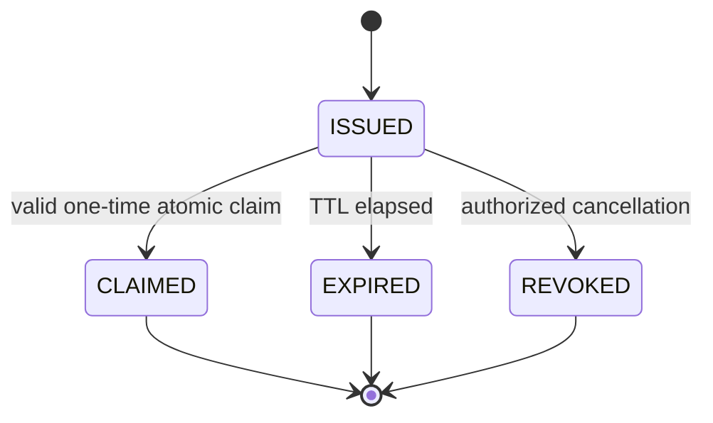
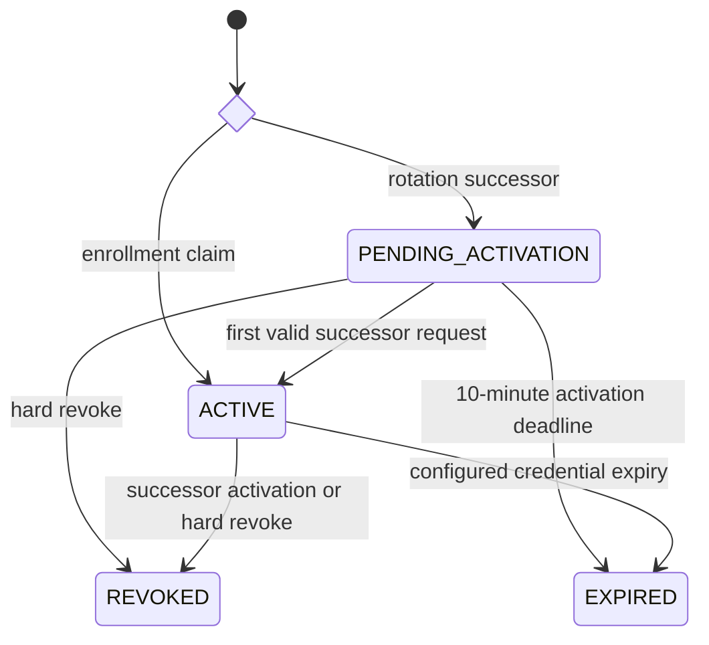
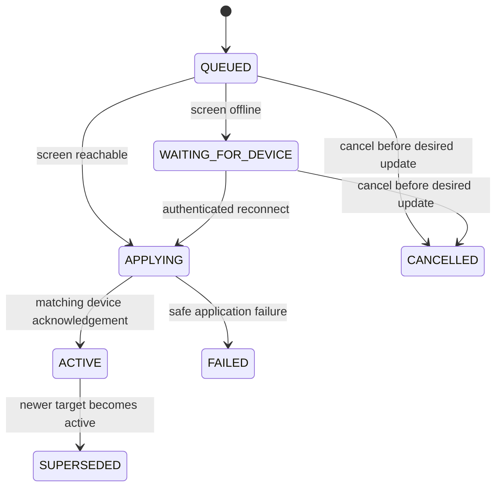

# P1 Target Configuration And Release Contract

## Document Status

- Lifecycle: `TARGET_NOT_IMPLEMENTED`
- Scope: enrollment, draft, release, publication, device acknowledgement and rollback
- Contract version: `p1.0-target-v1`
- Last reviewed: 2026-07-27

This contract defines later P1 behavior. No state machine or publication API in this file is implemented by the current POC.

## Configuration Resolution

The fixed inheritance order is:

```text
product default
-> tenant
-> deployment
-> site
-> screen group
-> screen instance
```

P1.0 does not implement emergency runtime overrides. A later contract may add an expiring override above ScreenInstance, but it cannot mutate a ConfigRelease.

Resolution rules:

- A scalar uses the nearest explicit value.
- `inherit` means no value at this layer; `disabled` is an explicit value.
- A list is replaced as a whole unless its schema explicitly declares `merge_by_id`.
- Every inheritance input is an immutable ConfigLayerRevision. Every referenced asset, profile, action pack, FineReport identity binding and Secret uses an exact immutable version; a bare mutable envelope ID is insufficient.
- Resolution produces one canonical effective configuration per target ScreenInstance.
- Validation creates an immutable ResolutionFingerprint containing the ordered target set, target-set hash, group revision, every ConfigLayerRevision, FineReport binding/Secret version and every per-screen effective-content hash.
- Preview and approval bind the same ResolutionFingerprint hash. Release creation re-resolves the sources, fails with `RESOLUTION_FINGERPRINT_STALE` on any mismatch, and atomically creates one immutable ReleaseTarget per resolved screen.
- Publication references those existing ReleaseTargets. It never resolves inheritance or creates release content.
- Canonical serialization sorts object keys, preserves list order and excludes volatile timestamps before computing SHA-256.

## Device Enrollment



| From | Operation | To | Required condition |
| --- | --- | --- | --- |
| none | issue | `ISSUED` | `device.enroll`, one ScreenInstance, reason, idempotency key |
| `ISSUED` | claim | `CLAIMED` | digest match, within 15 minutes, atomic unused check |
| `ISSUED` | expire | `EXPIRED` | server time reaches expiry |
| `ISSUED` | revoke | `REVOKED` | `device.enroll`, recent reauthentication |

Claim returns the initial DeviceCredential once and never changes the ScreenInstance selected at issuance. Any repeated, expired or revoked claim returns a safe failure and creates no credential.

## Device Credential Rotation

Enrollment claim and rotation use different entry states: `enrollment_claim -> ACTIVE`; `rotation_successor -> PENDING_ACTIVATION`.



The successor's first request and predecessor revocation commit atomically. Administrative hard revocation increments the screen credential epoch and revokes the complete credential family immediately. No request authenticated with an earlier epoch can commit afterward.

## Draft Lifecycle

```mermaid
stateDiagram-v2
    [*] --> DRAFT
    DRAFT --> VALIDATED: validation passes
    VALIDATED --> PREVIEWED: preview passes
    PREVIEWED --> APPROVAL_PENDING: submit exact revision
    APPROVAL_PENDING --> APPROVED: authorized approval
    APPROVAL_PENDING --> REJECTED: rejection with reason
    APPROVED --> RELEASED: create immutable release
    VALIDATED --> DRAFT: create revised draft revision
    PREVIEWED --> DRAFT: create revised draft revision
    REJECTED --> DRAFT: create revised draft revision
    APPROVAL_PENDING --> DRAFT: withdraw and revise
    APPROVED --> DRAFT: stale fingerprint; create new revision
    DRAFT --> ABANDONED: abandon
    VALIDATED --> ABANDONED: abandon
    PREVIEWED --> ABANDONED: abandon
    REJECTED --> ABANDONED: abandon
```



### Draft Rules

1. Content can change only in `DRAFT`, using `If-Match` against `resource_revision`.
2. Validation binds `draft_id`, `draft_revision`, `schema_version`, `content_hash` and the full ResolutionFingerprint.
3. A validation failure returns findings and leaves the draft in `DRAFT`.
4. Preview uses only a passed validation for the same revision and hash. A preview failure leaves the draft `VALIDATED`.
5. Approval binds the exact previewed revision, content hash and ResolutionFingerprint hash. A changed draft, group membership or inheritance source cannot reuse older evidence.
6. Revising a validated, previewed, pending, rejected or stale approved draft creates a new revision, preserves old evidence, invalidates pending approval and returns to `DRAFT`.
7. The standard production preset requires an approver different from the last content editor. Development/test may use an explicitly audited auto-approval policy.
8. `APPROVED` content cannot be edited in place; only a new revision may return the aggregate to `DRAFT`. `RELEASED` and `ABANDONED` are terminal.

## Immutable Release

Creating a release from `APPROVED` first recomputes and compares the bound ResolutionFingerprint. Any source or target-set mismatch fails without creating records and requires a new revision, validation, preview and approval. A match atomically produces:

- one ConfigRelease envelope with a new `release_id`, sequence, schema version and lineage;
- one ReleaseTarget per resolved ScreenInstance;
- each ReleaseTarget's full canonical effective configuration and SHA-256;
- exact asset/profile/action-pack versions and Secret references;
- validation, preview and approval evidence references;
- the bound ResolutionFingerprint and its target-set, source-revision and per-screen hashes;
- `created_by`, reason and request ID.

ConfigRelease and ReleaseTarget have no update or delete operation. A retired release remains readable and may be selected as rollback source.

## Publication

### Frozen Target Plan

Before applying any target, the service records:

- publication ID and idempotency request hash;
- ConfigRelease ID;
- Site or ScreenGroup revision when applicable;
- ordered resolved ScreenInstance IDs and target-set SHA-256;
- one matching ReleaseTarget ID per screen;
- each target's expected RuntimeBinding generation;
- actor, approval evidence, reason and creation time.

A group membership change after release creation does not change its targets. Group publication requires the current group `If-Match` ETag to equal the revision bound by the release and includes every target's current RuntimeBinding ETag and expected `binding_generation`; a mismatch fails before the plan commits. Single-screen publication requires the RuntimeBinding `If-Match` ETag plus its expected generation.

### Per-Screen State



The control plane atomically compares the RuntimeBinding ETag and expected generation and updates only that target's desired release. It then increments the generation. The applied release does not change until the credential-bound device acknowledges the exact ReleaseTarget hash.

`cancelPublicationTarget` can move only `QUEUED` or `WAITING_FOR_DEVICE` for the addressed `(publication_id, screen_id)` to `CANCELLED`, using that target's ETag. It never edits the immutable Publication plan and cannot cancel `APPLYING`, `ACTIVE` or another screen's target.

A parent group operation reports per-target results and one of `SUCCEEDED`, `PARTIAL_FAILURE`, `FAILED` or `CANCELLED`. Partial failure never rolls a successful screen onto another screen's release and is never reported as total success.

### Offline And Failure Behavior

- An offline screen keeps its last applied release and enters `WAITING_FOR_DEVICE`.
- A device with revoked credentials cannot fetch or acknowledge a new target.
- Hash, schema, asset or Secret-decryption failure leaves the previous release applied and marks only that target `FAILED`.
- An acknowledgement for an older generation is stored as stale evidence and cannot move the current binding.
- A permission denial is final; it never invokes a broader fallback.

## Rollback

Rollback is a forward operation:

1. Select a historical ReleaseTarget owned by the same screen.
2. Verify the historical target's exact immutable asset, FineReport binding and Secret versions remain permitted and decryptable without reading Secret values. A replacement version requires a new normal draft/approval, not silent substitution.
3. Create a new ConfigRelease and ReleaseTarget with new lineage while copying the approved historical effective content and exact versions.
4. Set `rollback_of_release_id` and `rollback_source_target_id`.
5. Publish through the normal frozen-target and optimistic-concurrency path.
6. Preserve the old active release until the device acknowledges the new rollback target.

Rollback cannot change, reactivate by pointer, or delete a historical release.

Production publication and rollback additionally consume a matching approved HighRiskAction. The action binds the exact release/rollback source, target set, ETags, generations, reason and normalized request hash; its approver must differ from its initiator.

## Restore Interaction

Restore uses a maintenance epoch:

- entering execution rejects new writes and waits for in-flight writes to finish;
- the restore plan binds the backup hash, schema version and pre-restore control-plane epoch;
- data restores into a new location and is verified before switching;
- success increments control-plane, user-authentication and device-credential epochs;
- pre-restore browser and device sessions cannot commit after the switch;
- an independent RecoverySecurityLedger and external monotonic anchor prevent restored account, password-generation or device-revocation state from rolling backward;
- each restored RuntimeBinding is checked for same-screen ownership and exact release hash.

## Three-Screen Isolation Walkthrough

Initial bindings:

```text
screen-01: desired A, applied A, generation 10
screen-02: desired B, applied B, generation 17
screen-03: desired C, applied C, generation 4
```

Publish release D only to screen 2 with expected generation 17:

```text
screen-01: desired A, applied A, generation 10
screen-02: desired D, applied B, generation 18
screen-03: desired C, applied C, generation 4
```

After screen 2 acknowledges D:

```text
screen-01: desired A, applied A, generation 10
screen-02: desired D, applied D, generation 18
screen-03: desired C, applied C, generation 4
```

An operation that changes screen 1 or screen 3, or reports D as applied before the acknowledgement, fails the P1 isolation gate.

## Illegal Transitions

The following are always rejected:

- claim an enrollment more than once;
- authenticate with a revoked credential or an older credential epoch;
- edit content outside `DRAFT`;
- preview an unvalidated revision;
- approve a different revision or hash from the preview;
- approve or release after any ResolutionFingerprint source changed;
- create a release without valid approval evidence;
- update or delete ConfigRelease or ReleaseTarget;
- publish a ReleaseTarget owned by another screen;
- create a ReleaseTarget during Publication;
- attach a PublicationTarget whose release or screen differs from its ReleaseTarget;
- silently recalculate a committed group target set;
- acknowledge a target from a credential bound to another screen;
- rollback by mutating or repointing a historical release.
