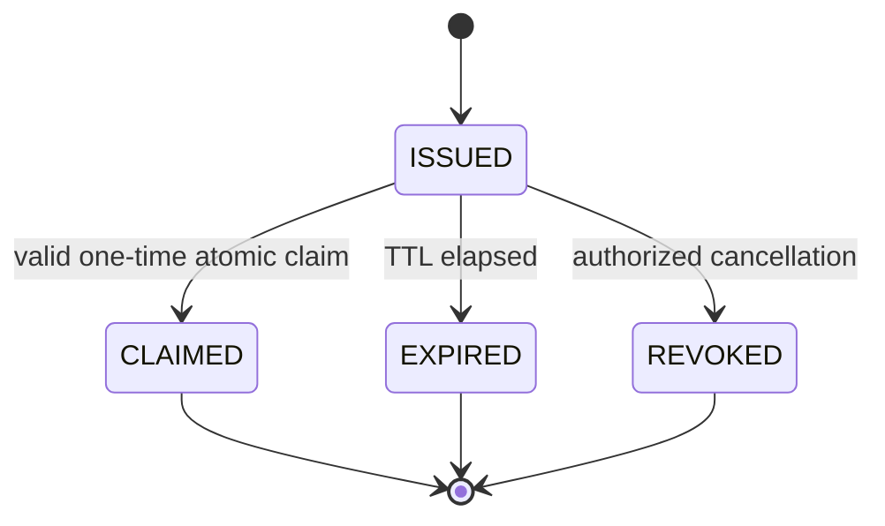
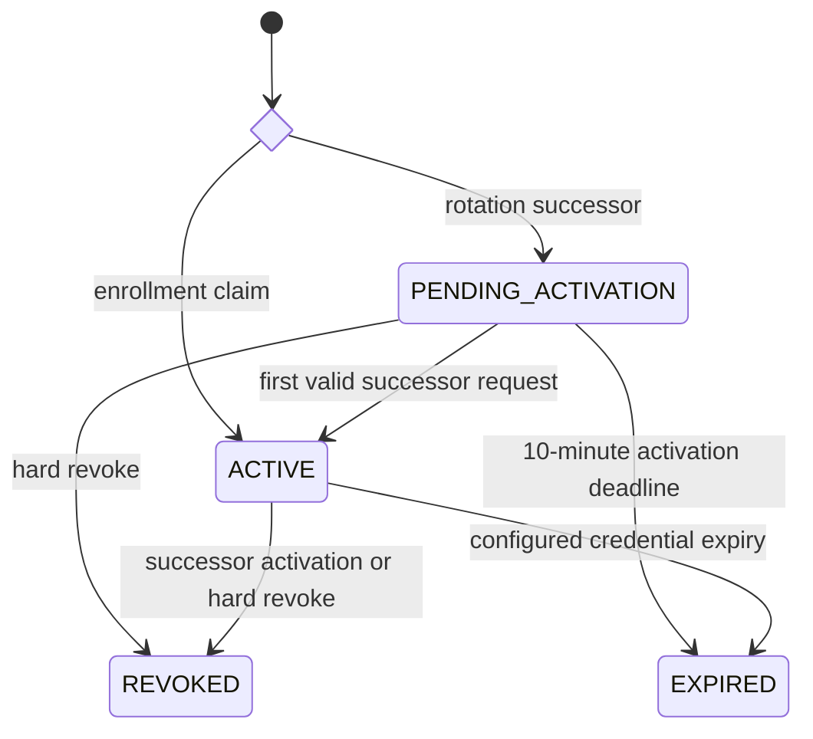
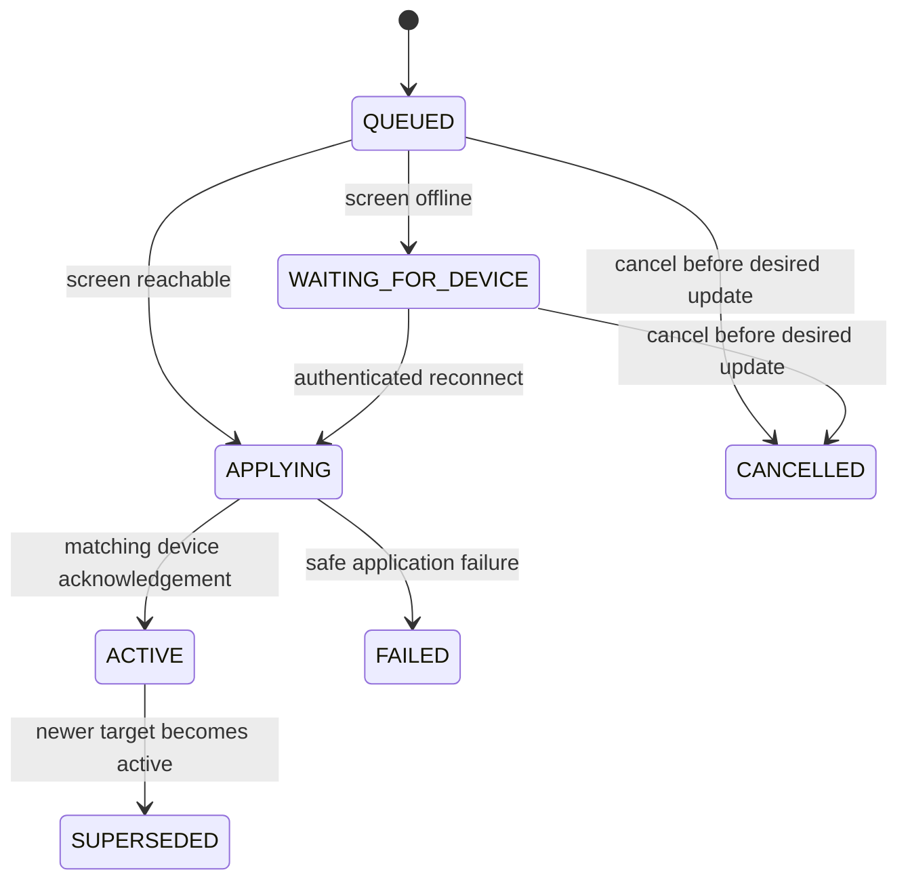

# P1 Target Configuration And Release Contract

## Document Status

- Lifecycle: `TARGET_NOT_IMPLEMENTED`
- Scope: enrollment, draft, release, publication, device acknowledgement and rollback
- Contract version: `p1.0-target-v1`
- Last reviewed: 2026-07-27

This contract defines later P1 behavior. No state machine or publication API in this file is implemented by the current POC.

## Configuration Resolution

The fixed inheritance order is:

```text
product default
-> tenant
-> deployment
-> site
-> screen group
-> screen instance
```

P1.0 does not implement emergency runtime overrides. A later contract may add an expiring override above ScreenInstance, but it cannot mutate a ConfigRelease.

Deployment mode/posture is a hard outer gate. In `SETUP`, configuration may be created, edited, validated and previewed, but cannot be submitted/approved for production, turned into a production release, published, rolled back or delivered to a device; device enrollment/claim/rotation/runtime authentication and Secret/FineReport credential activation are also forbidden. After irreversible activation, `PRODUCTION_ACTIVE/RECOVERY_REQUIRED` denies all configuration and publication mutation. Its two allowed device reads return only the last acknowledged applied target; normal publication/runtime delivery resumes only after local production-readiness recovery appends a verified READY fence successor.

Resolution rules:

- A scalar uses the nearest explicit value.
- `inherit` means no value at this layer; `disabled` is an explicit value.
- A list is replaced as a whole unless its schema explicitly declares `merge_by_id`.
- Every inheritance input is an immutable ConfigLayerRevision. Every referenced asset, profile, action pack, FineReport identity binding and Secret uses an exact immutable version; a bare mutable envelope ID is insufficient.
- Resolution produces one canonical effective configuration per target ScreenInstance.
- Validation creates an immutable ResolutionFingerprint containing the ordered target set, target-set hash, group revision, every ConfigLayerRevision, FineReport binding/Secret version and every per-screen effective-content hash.
- Preview and approval bind the same ResolutionFingerprint hash. Release creation re-resolves the sources, fails with `RESOLUTION_FINGERPRINT_STALE` on any mismatch, and atomically creates one immutable ReleaseTarget per resolved screen.
- Publication references those existing ReleaseTargets. It never resolves inheritance or creates release content.
- Canonical serialization sorts object keys, preserves list order and excludes volatile timestamps before computing SHA-256.

## Device Enrollment



| From | Operation | To | Required condition |
| --- | --- | --- | --- |
| none | issue | `ISSUED` | `device.enroll`, one ScreenInstance, reason, idempotency key, production four eyes, expected family generation and ledger head |
| `ISSUED` | claim | `CLAIMED` | digest match, within 15 minutes, atomic unused check |
| `ISSUED` | expire | `EXPIRED` | server time reaches expiry |
| `ISSUED` | revoke | `REVOKED` | `device.enroll`, recent reauthentication |

Claim returns the initial DeviceCredential once and never changes the ScreenInstance selected at issuance. The claim transaction also enforces the partial unique constraint of at most one `ACTIVE` DeviceCredentialFamily per screen; if one already exists it returns `ACTIVE_DEVICE_FAMILY_EXISTS` and creates nothing. Any repeated, expired or revoked claim returns a safe failure and creates no credential.

## Device Credential Rotation

Enrollment claim and rotation use different entry states: `enrollment_claim -> ACTIVE`; `rotation_successor -> PENDING_ACTIVATION`.



Rotation locks the active DeviceCredentialFamily and compares both expected credential epoch and family generation. A family has at most one `ACTIVE` DeviceCredential and at most one `PENDING_ACTIVATION` successor; concurrent requests with different idempotency keys produce one successor and `SUCCESSOR_ALREADY_PENDING` or `RESOURCE_VERSION_CONFLICT` for the loser. Creation increments family generation exactly once. The successor's first request compares its issued epoch/generation, then predecessor revocation, successor activation and one further family-generation increment commit atomically, so two credentials can never remain `ACTIVE` in one family. Administrative hard revocation increments the screen credential epoch and revokes the complete credential family immediately. No request authenticated with an earlier epoch can commit afterward.

DeviceCredentialFamily starts `ACTIVE` and can move only to terminal `REVOKED` by hard family revocation or terminal `REENROLL_REQUIRED` when recovery finds an older/mismatched active version. A new enrollment creates a new family; neither terminal state reopens.

## Draft Lifecycle

```mermaid
stateDiagram-v2
    [*] --> DRAFT
    DRAFT --> VALIDATED: validation passes
    VALIDATED --> PREVIEWED: preview passes
    PREVIEWED --> APPROVAL_PENDING: submit exact revision
    APPROVAL_PENDING --> APPROVED: authorized approval
    APPROVAL_PENDING --> REJECTED: rejection with reason
    APPROVED --> RELEASED: create immutable release
    VALIDATED --> DRAFT: create revised draft revision
    PREVIEWED --> DRAFT: create revised draft revision
    REJECTED --> DRAFT: create revised draft revision
    APPROVAL_PENDING --> DRAFT: withdraw and revise
    APPROVED --> DRAFT: stale fingerprint or control-plane epoch; create new revision
    DRAFT --> ABANDONED: abandon
    VALIDATED --> ABANDONED: abandon
    PREVIEWED --> ABANDONED: abandon
    REJECTED --> ABANDONED: abandon
```



### Draft Rules

1. `createConfigDraft` accepts only a target envelope and `schema_version`; an initial `spec` is forbidden. It creates a `DRAFT` with an empty working spec. `replaceConfigDraftSpec` is the only initial-population path and applies complete field-level authorization.
2. Content can change only in `DRAFT`, using `If-Match` against `resource_revision`.
3. Validation binds `draft_id`, `draft_revision`, `schema_version`, `content_hash` and the full ResolutionFingerprint.
4. A validation failure returns findings and leaves the draft in `DRAFT`.
5. Preview uses only a passed validation for the same revision and hash. A preview failure leaves the draft `VALIDATED`.
6. Approval binds the exact previewed revision, content hash, ResolutionFingerprint hash and control-plane epoch. A changed draft, group membership, inheritance source or restore epoch cannot reuse older evidence.
7. `reviseConfigDraft` is a copy-only state transition from `VALIDATED`, `PREVIEWED`, `APPROVAL_PENDING`, `REJECTED`, or `APPROVED` only when its ResolutionFingerprint or bound control-plane epoch is stale. It copies the current spec into a new revision, preserves history, invalidates validation/preview/approval evidence, atomically withdraws a pending approval and returns to `DRAFT`; later field changes use `replaceConfigDraftSpec`.
8. The standard production preset requires an approver different from the last content editor. Development/test may use an explicitly audited auto-approval policy.
9. `APPROVED` content cannot be edited in place; only a new revision may return the aggregate to `DRAFT`. `RELEASED` and `ABANDONED` are terminal.
10. `abandonConfigDraft` is allowed only from `DRAFT`, `VALIDATED`, `PREVIEWED` or `REJECTED`; it preserves all revisions and evidence and creates no delete path.

## Immutable Release

Every ConfigRelease declares exactly one `creation_kind`.

- `NORMAL` first recomputes and compares an `APPROVED` draft's bound ResolutionFingerprint. Any source or target-set mismatch fails without creating records and requires `reviseConfigDraft`, validation, preview and approval.
- `ROLLBACK` has no normal-draft provenance. It requires the approved rollback HighRiskAction and an immutable per-destination-screen source map keyed by tenant, deployment, source release, source screen, source ReleaseTarget and destination screen. Source and destination screen must be identical, and the copied canonical content/hash plus asset, FineReport and Secret versions must exactly equal the permitted historical source.

The database CHECK requires exactly one provenance branch. Either branch atomically produces:

- one ConfigRelease envelope with a new `release_id`, sequence, schema version and lineage;
- one ReleaseTarget per resolved ScreenInstance;
- each ReleaseTarget's full canonical effective configuration and SHA-256;
- exact asset/profile/action-pack versions and Secret references;
- for `NORMAL`, validation, preview, approval and bound ResolutionFingerprint references;
- for `ROLLBACK`, source release/target-map hash, target-set hash and consumed HighRiskAction reference;
- `created_by`, reason and request ID.

ConfigRelease and ReleaseTarget have no update or delete operation. A retired release remains readable and may be selected as rollback source.

## Publication

### Frozen Target Plan

Before applying any target, the service records:

- publication ID and idempotency request digest;
- ConfigRelease ID;
- Site or ScreenGroup revision when applicable;
- ordered resolved ScreenInstance IDs and target-set SHA-256;
- one matching ReleaseTarget ID per screen;
- each target's expected RuntimeBinding generation;
- actor, approval evidence, reason and creation time.

A group membership change after release creation does not change its targets. Group publication requires the current group `If-Match` ETag to equal the revision bound by the release and includes every target's current RuntimeBinding ETag and expected `binding_generation`; a mismatch fails before the plan commits. Single-screen publication requires the RuntimeBinding `If-Match` ETag plus its expected generation.

### Per-Screen State



The control plane atomically compares the RuntimeBinding ETag and expected generation and updates only that target's desired release. It then increments the generation. The applied release does not change until the credential-bound device acknowledges the exact ReleaseTarget hash.

`cancelPublicationTarget` can move only `QUEUED` or `WAITING_FOR_DEVICE` for the addressed `(publication_id, screen_id)` to `CANCELLED`, using that target's ETag. It never edits the immutable Publication plan and cannot cancel `APPLYING`, `ACTIVE` or another screen's target.

A parent group operation reports per-target results and one of `SUCCEEDED`, `PARTIAL_FAILURE`, `FAILED` or `CANCELLED`. Partial failure never rolls a successful screen onto another screen's release and is never reported as total success.

### Offline And Failure Behavior

- An offline screen keeps its last applied release and enters `WAITING_FOR_DEVICE`.
- A device with revoked credentials cannot fetch or acknowledge a new target.
- Hash, schema, asset or Secret-decryption failure leaves the previous release applied and marks only that target `FAILED`.
- An acknowledgement for an older generation is stored as stale evidence and cannot move the current binding.
- A permission denial is final; it never invokes a broader fallback.

## Rollback

Rollback is a forward operation:

1. Select a historical ReleaseTarget owned by the same screen and freeze the complete source-to-destination target map.
2. Verify the historical target's exact immutable asset, FineReport binding and Secret versions remain permitted and decryptable without reading Secret values. A replacement version requires a new normal draft/approval, not silent substitution.
3. Create a `ROLLBACK` ConfigRelease and ReleaseTarget with new lineage while copying the historical effective content, hash and exact versions byte-for-byte. The normal draft/fingerprint/ApprovalRecord columns are null; the rollback source-map and consumed HighRiskAction columns are populated.
4. Store `rollback_source_map_hash` on the new ConfigRelease and `rollback_source_release_id` / `rollback_source_target_id` on each new ReleaseTarget. Map destinations are unique and equal the new release target set; mixed historical source releases are allowed only through those per-target records.
5. Publish through the normal frozen-target and optimistic-concurrency path.
6. Preserve the old active release until the device acknowledges the new rollback target.

Rollback cannot change, reactivate by pointer, or delete a historical release.

Production publication and rollback additionally consume a matching approved HighRiskAction. The action binds the exact release/rollback source, target set, ETags, generations, reason and normalized-command HMAC-SHA-256 digest; its approver must differ from its initiator.

## Restore Interaction

Restore uses a maintenance epoch:

- entering execution rejects new writes and waits for in-flight writes to finish;
- maintenance/local recovery serves no control-plane or device traffic during cutover. A safe pre-pointer abort may return the retained online store; `SETUP` remains externally unserved, and every finalized production restore remains `RECOVERY_REQUIRED` until a separate local readiness recovery appends the matching READY successor;
- the restore plan binds backup hash, schema version, pre-restore control-plane epoch, exactly one recovery-source mode and exactly one authorization kind/evidence ID;
- `NORMAL_API_FOUR_EYES` implies `ONLINE_ACTIVE_STORE`; full loss requires `LOCAL_DISASTER_QUORUM`; local+online is legal only when no credential-usable administrator can authenticate;
- data restores into a new location and is verified before switching;
- success increments control-plane, user-authentication and device-credential epochs;
- pre-restore browser/device sessions cannot commit after the switch, and every one-time response replay ciphertext is deleted;
- an independent RecoverySecurityLedger and external monotonic anchor replace restored role/scope assignments with the latest authoritative snapshot and prevent account, password, device, Secret or FineReport security generations from rolling backward;
- restored pending/approved HighRiskActions fail and config approvals must be repeated in the new control-plane epoch;
- online mode captures the live audit head, fences producers, carries full canonical SecurityAuditSuffix events and retains the previous pointer; full loss has null previous pointer, no live barrier, an empty backup-head-to-backup-head suffix and signed ExternalRecoveryAudit;
- continuity computes its payload/hash, performs `append/fsync PREPARED`, then authenticates a nonce-protected HMAC envelope whose schema and RestoreCutoverRecord bind `recovery_source_mode`, authorization evidence and key IDs;
- pointer switch is forbidden until all three complete RuntimeBindings and every applicable source-mode check match; online also rechecks the barrier head, while full loss never fabricates one;
- the shared RecoveryPasswordSetupGrant branch is exact: normal restore issues one or two only for stale/missing selected-admin credentials, disaster issues one in `SETUP` or two in production, and readiness replacement issues one; every grant binds the same branch-specific prepared sequence, reaches `COMMITTED_CONSUMED` only with its restore/readiness anchors, and whole-set abort destroys provisional verifiers plus terminally consumes the nonce;
- pointer replacement is not atomic with a database state mark; actual-pointer plus authenticated RestoreCutoverRecord evidence drives idempotent recovery, and after anchor commitment one transaction finalizes RestorePlan, AsyncOperation, OutboxRecord, IdempotencyRecord, RestoreCutoverRecord and audit without redispatch;
- each restored RuntimeBinding is checked for same-screen ownership and exact release hash.

## Three-Screen Isolation Walkthrough

Initial bindings:

```text
screen-01: DHI human-01, desired A, applied A, generation 10, ack ack-A-10
screen-02: DHI human-02, desired B, applied B, generation 17, ack ack-B-17
screen-03: DHI human-03, desired C, applied C, generation 4, ack ack-C-4
```

Publish release D only to screen 2 with expected generation 17:

```text
screen-01: DHI human-01, desired A, applied A, generation 10, ack ack-A-10
screen-02: DHI human-02, desired D, applied B, generation 18, ack ack-B-17
screen-03: DHI human-03, desired C, applied C, generation 4, ack ack-C-4
```

After screen 2 acknowledges D:

```text
screen-01: DHI human-01, desired A, applied A, generation 10, ack ack-A-10
screen-02: DHI human-02, desired D, applied D, generation 18, ack ack-D-18
screen-03: DHI human-03, desired C, applied C, generation 4, ack ack-C-4
```

Each line is the complete fixture projection of RuntimeBinding, including DigitalHumanInstance and the last-acknowledgement marker. An operation that changes any field of screen 1 or screen 3, changes screen 2's DigitalHumanInstance, advances its acknowledgement marker before the device acknowledgement, or reports D as applied before that acknowledgement fails the P1 isolation gate.

## Illegal Transitions

The following are always rejected:

- claim an enrollment more than once;
- authenticate with a revoked credential or an older credential epoch;
- edit content outside `DRAFT`;
- preview an unvalidated revision;
- approve a different revision or hash from the preview;
- approve or release after any ResolutionFingerprint source changed;
- create a `NORMAL` release without valid draft approval/fingerprint evidence, or a `ROLLBACK` release without exact historical provenance and an approved HighRiskAction;
- update or delete ConfigRelease or ReleaseTarget;
- publish a ReleaseTarget owned by another screen;
- create a ReleaseTarget during Publication;
- attach a PublicationTarget whose release or screen differs from its ReleaseTarget;
- silently recalculate a committed group target set;
- acknowledge a target from a credential bound to another screen;
- change any non-target screen's RuntimeBinding field, including DigitalHumanInstance or last-acknowledgement marker;
- rollback by mutating or repointing a historical release.
