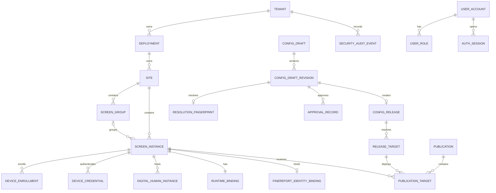

# P1 Target Data Model

## Document Status

- Lifecycle: `TARGET_NOT_IMPLEMENTED`
- Scope: engine-portable relational model and integrity rules for P1
- Contract version: `p1.0-target-v1`
- Logical schema version: `p1_control_plane_001`
- Last reviewed: 2026-07-27

This is a conceptual target schema. It is not a migration and does not change the current POC database.

Canonical entity names include `SecretRecord`, `ConfigDraftRevision`, `ResolutionFingerprint`, `HighRiskAction`, `BackupRecord` and `RecoverySecurityLedger`; physical names follow the `snake_case` convention below.

## Storage Conventions

- UUIDv7 IDs are generated by the service and stored in canonical lowercase form; PostgreSQL may use `uuid`, while SQLite uses checked text.
- All timestamps are UTC and assigned by the service transaction.
- Every tenant-owned table contains `tenant_id` and `deployment_id`.
- Parent uniqueness includes the ownership columns needed for composite foreign keys.
- Mutable rows use `resource_revision bigint not null`, incremented exactly once per successful mutation.
- Flexible configuration uses versioned canonical JSON only where fields are intentionally schema-driven. Unknown write fields are rejected.
- Secret values never appear in ordinary JSON. Only `secret_ref` is allowed.
- Enumerations use the exact names in [p1-target-contract.json](p1-target-contract.json).

## Relationship Overview

## Organization And Screen Tables

| Table | Critical fields | Required constraints |
| --- | --- | --- |
| `tenant` | `tenant_id`, `slug`, `status`, `resource_revision` | unique slug; no cross-tenant move |
| `deployment` | `deployment_id`, `tenant_id`, `environment`, `control_plane_epoch`, `resource_revision` | unique `(tenant_id, environment)` |
| `site` | `site_id`, ownership IDs, `slug`, `timezone`, `status`, `resource_revision` | unique `(tenant_id, deployment_id, slug)` |
| `screen_group` | `screen_group_id`, ownership IDs, `site_id`, `slug`, `resource_revision` | composite FK to Site; unique slug inside Site |
| `screen_instance` | `screen_id`, ownership IDs, `site_id`, nullable `screen_group_id`, `slug`, `lifecycle_state`, `resource_revision` | group must belong to same Site; unique screen slug inside Site |
| `digital_human_instance` | `digital_human_instance_id`, ownership IDs, `screen_id`, `status`, `resource_revision` | same-screen composite FK; partial unique one active per screen |
| `finereport_identity_binding` | `binding_id`, ownership IDs, `screen_id`, active binding-version ID, `resource_revision` | unique active binding envelope per screen; no credential value |
| `finereport_identity_binding_version` | binding/version ID, connector ref, immutable SecretVersion ref, identity kind, created actor/time | append-only; exact version can be bound by ReleaseTarget |
| `runtime_binding` | ownership IDs, `screen_id`, `digital_human_instance_id`, desired/applied release target IDs, `binding_generation`, acknowledgement time | primary key screen ID; same-screen references; generation compare-and-swap |

`screen_instance` is retired through state, not deleted. Group removal sets the nullable membership after a revision check and cannot change a frozen Publication target.

## User And Device Trust Tables

| Table | Critical fields | Required constraints |
| --- | --- | --- |
| `user_account` | `user_id`, ownership IDs, normalized username, enabled, account-state generation, password generation/state, authentication/authorization epochs, last ledger sequence, lock fields, `resource_revision` | unique normalized username inside tenant/deployment; security generations monotonic |
| `bootstrap_grant` | grant digest, state, issued/expiry/consumed time | single-use legal transitions; invalidated after first administrator creation |
| `password_credential` | `user_id`, Argon2id hash, algorithm parameters, credential generation, changed time | one current credential; no plaintext; generation monotonic |
| `role_definition` | stable role and permission IDs | built-in rows are versioned product data |
| `user_role` | ownership IDs, `user_id`, role ID | unique assignment; same-boundary FK |
| `auth_session` | non-secret record ID, session digest, user ID, state, authentication/authorization epochs, idle/absolute expiry, reauthenticated time, revocation fields, `resource_revision` | unique digest; list returns only record ID and safe metadata; revoked/expired sessions unusable |
| `password_reset_token` | token digest, user ID, state, expiry, consumed time | unique digest; `ISSUED -> CONSUMED | EXPIRED | REVOKED`; single atomic consume |
| `device_enrollment` | enrollment ID, screen ID, token digest, state, expiry, consumed time | one token digest; legal transitions only |
| `device_credential` | credential ID, screen ID, family ID, credential version, keyed verifier, state, epoch, predecessor ID | unique `(family_id, credential_version)`; revoked versions unusable |
| `secret_record` | `secret_ref`, owner IDs, type, current version ID, rotation metadata, `resource_revision` | mutable envelope; no read path for ciphertext |
| `secret_version` | Secret version ID, owner/ref, ciphertext, key version, created actor/time | append-only encrypted value; exact version can be bound by immutable release |

Authentication and device tables are not subject to the three-day conversation-log cleanup.

## Draft, Release And Publication Tables

| Table | Critical fields | Required constraints |
| --- | --- | --- |
| `config_draft` | draft ID, ownership IDs, state, current revision number, `resource_revision` | mutable only in `DRAFT` |
| `config_draft_revision` | draft ID, revision, schema version, canonical content, content hash, created actor/time | unique `(draft_id, revision)`; immutable once validated |
| `config_layer_revision` | owner type/ID, layer revision, canonical layer patch, content hash, created actor/time | immutable; unique owner/revision; active pointer lives on the owning aggregate |
| `resolution_fingerprint` | fingerprint ID/hash, revision ID, target-set hash, group revision, inheritance-layer revisions, per-screen effective hashes | immutable exact resolution bound to validation, preview and approval |
| `validation_record` | revision ID, fingerprint ID/hash, outcome, findings hash, validator version | exact revision/content/resolution binding |
| `preview_record` | revision ID, validation ID, fingerprint hash, outcome, evidence hash | only passed validation; same fingerprint |
| `approval_record` | revision ID, preview ID, fingerprint hash, actor, decision, reason | append-only; exact revision/content/resolution binding |
| `config_release` | release ID, sequence, source revision, fingerprint hash, schema version, lineage, created actor/time | immutable; unique sequence per deployment |
| `release_target` | target ID, release ID, screen ID, canonical effective content, content hash | created atomically with release; unique `(release_id, screen_id)`; same-screen resolved content |
| `publication` | publication ID, release ID, target-set hash, group/site revision, actor, reason, operation state | immutable request plan; never creates ReleaseTarget |
| `publication_target` | publication ID, release ID, release target ID, screen ID, expected/current ETag and binding generation, state, failure code | unique `(publication_id, screen_id)`; composite FK proves same release and screen |
| `runtime_binding_history` | screen ID, old/new desired/applied target IDs, generation, publication ID, actor/device, event time | append-only |

ConfigRelease does not store mutable “current” fields. Current intent and device report live only in RuntimeBinding; history is append-only.

## Operations, Backup And Audit Tables

| Table | Critical fields | Required constraints |
| --- | --- | --- |
| `idempotency_record` | principal, scope, method, canonical route, key digest, request hash, result reference, expiry | unique scoped key; same key/different hash conflicts |
| `high_risk_action` | action ID, typed operation ID, normalized request hash, target revisions/generations, initiator, approver, reason, expiry, state | allowlisted typed schema; different-user approval; immutable after one-time consume |
| `async_operation` | operation ID, kind, state, progress, safe failure code, timestamps | no Secret or complete sensitive payload |
| `backup_record` | backup ID, storage profile, manifest hash, schema/product version, state, verification time | manifest contains no Secret values or DSNs |
| `restore_plan` | plan ID, backup hash, source/current schema, expected control-plane epoch, findings, state | execution bound to exact validated plan |
| `recovery_security_ledger_ref` | external ledger sequence, anchored chain head, observed time | reference only; ledger and anchor are outside the live store and backup root |
| `schema_migration` | migration ID, checksum, applied time, product version | append-only unique ID/checksum |
| `security_audit_event` | event ID, ownership, actor type/ID, action, resource, result, reason, request ID, previous hash, event hash | insert only; per-boundary hash chain |

The application database role has no ordinary update/delete path for security audit, release, approval, publication plan, binding history or migration records. Product maintenance retains them according to an explicit policy, never the three-day runtime-log policy.

## Integrity Rules

### Boundary Keys

Every reference capable of crossing screen or tenant scope uses an ownership-aware composite key. Examples:

- ScreenGroup reference: `(tenant_id, deployment_id, site_id, screen_group_id)`.
- DigitalHumanInstance reference: `(tenant_id, deployment_id, screen_id, digital_human_instance_id)`.
- ReleaseTarget reference: `(tenant_id, deployment_id, screen_id, release_target_id)`.
- PublicationTarget reference: `(tenant_id, deployment_id, release_id, screen_id, release_target_id)` must reference ReleaseTarget `(tenant_id, deployment_id, release_id, screen_id, release_target_id)`; its `(tenant_id, deployment_id, publication_id, release_id)` also references Publication.

An ID that exists in another boundary is treated as not found, not automatically rebound.

### Optimistic Concurrency

- GET returns a strong ETag derived from resource ID and `resource_revision`.
- Control-plane mutations of an existing mutable resource require `If-Match`; missing returns 428 and stale returns 412.
- The successful transaction compares the expected revision and increments it once.
- Single-screen publication/rollback compare both the RuntimeBinding ETag and `binding_generation`.
- Group publication/rollback compare the ScreenGroup ETag plus every target RuntimeBinding ETag and generation before any target write.
- Device acknowledgement is the explicit exception to HTTP ETag: it uses credential-scoped CAS on `binding_generation` plus ReleaseTarget content hash because the device cannot select another mutable resource.

### Immutability

- ConfigRelease, ReleaseTarget, approval evidence, Publication plan, audit event and binding history have no update API.
- PublicationTarget status may follow its exact state machine; cancellation changes only an eligible target row and does not edit the Publication plan.
- Rollback inserts new records.
- Retention marks eligible records and creates a maintenance audit event; it never cascades through security evidence.

### Idempotency

High-risk POST commands persist a request hash and result reference in the same transaction as the domain change. Repeating the same key and request returns the same resource or Operation. Reusing the key with different content returns `IDEMPOTENCY_KEY_REUSED`.

## Retention Classes

| Class | Default | Includes | Explicit exclusions |
| --- | --- | --- | --- |
| Runtime detail | 3 days, configurable | conversation detail, transient provider payload metadata, verbose runtime logs | users, auth policy, releases, publications, security audit |
| Operational metrics | product policy, aggregated after detailed expiry | latency, counts, health events | raw Secret or full customer question |
| Security and change evidence | retained until explicit governed purge/export policy | user, role, credential revocation, config, release, restore, audit | never cleaned by runtime retention |
| Backup catalog | 24 hourly, 7 daily, 4 weekly by default | manifests, hashes, verification and restore history | recovery key |

## Migration Contract

- Migrations are forward-only, ordered and checksummed.
- Startup never silently migrates a production database.
- Upgrade performs compatibility preflight, verified backup, migration on a copy or transaction where supported, integrity checks and explicit cutover.
- A failed migration keeps the previous accepted database and product version recoverable.
- Engine-portable logical export uses stable field names and explicit schema version; engine-specific native snapshots are supplemental.
- Downgrade is restore of the previous accepted product plus compatible backup, not an automatically generated reverse migration.

## Three-Screen Constraint Fixture

The machine contract fixture creates three ScreenInstances with three distinct DigitalHumanInstance IDs, RuntimeBindings and initial ReleaseTargets. A single-screen publication must:

- insert one PublicationTarget for screen 2;
- compare only screen 2's binding generation;
- change only screen 2's desired target;
- leave screens 1 and 3 byte-for-byte unchanged;
- record one screen-scoped history event.

Any schema or transaction design unable to prove those assertions is not acceptable for P1 implementation.
