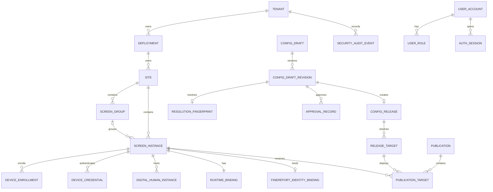

# P1 Target Data Model

## Document Status

- Lifecycle: `TARGET_NOT_IMPLEMENTED`
- Scope: engine-portable relational model and integrity rules for P1
- Contract version: `p1.0-target-v1`
- Logical schema version: `p1_control_plane_001`
- Last reviewed: 2026-07-27

This is a conceptual target schema. It is not a migration and does not change the current POC database.

Canonical entity names include `SecretRecord`, `ConfigDraftRevision`, `ResolutionFingerprint`, `HighRiskAction`, `BackupRecord` and `RecoverySecurityLedger`; physical names follow the `snake_case` convention below.

## Storage Conventions

- UUIDv7 IDs are generated by the service and stored in canonical lowercase form; PostgreSQL may use `uuid`, while SQLite uses checked text.
- All timestamps are UTC and assigned by the service transaction.
- Every tenant-owned table contains `tenant_id` and `deployment_id`.
- Parent uniqueness includes the ownership columns needed for composite foreign keys.
- Mutable rows use `resource_revision bigint not null`, incremented exactly once per successful mutation.
- Flexible configuration uses versioned canonical JSON only where fields are intentionally schema-driven. Unknown write fields are rejected.
- Secret values never appear in ordinary JSON. Only `secret_ref` is allowed.
- Enumerations use the exact names in [p1-target-contract.json](p1-target-contract.json).

## Relationship Overview

## Organization And Screen Tables

| Table | Critical fields | Required constraints |
| --- | --- | --- |
| `tenant` | `tenant_id`, `slug`, `status`, `resource_revision` | unique slug; no cross-tenant move |
| `deployment` | `deployment_id`, `tenant_id`, `environment`, `deployment_mode`, mode generation, effective operational posture/access gate, external fence generation/evidence hash, readiness snapshot hash, control-plane epoch, last ledger sequence, `resource_revision` | unique `(tenant_id, environment)`; initial `SETUP`; only ledger-backed irreversible `SETUP -> PRODUCTION_ACTIVE`; production `READY <-> RECOVERY_REQUIRED` is derived from the highest verified external fence |
| `site` | `site_id`, ownership IDs, `slug`, `timezone`, `status`, `resource_revision` | unique `(tenant_id, deployment_id, slug)` |
| `screen_group` | `screen_group_id`, ownership IDs, `site_id`, `slug`, `resource_revision` | composite FK to Site; unique slug inside Site |
| `screen_instance` | `screen_id`, ownership IDs, `site_id`, nullable `screen_group_id`, `slug`, `lifecycle_state`, `resource_revision` | group must belong to same Site; unique screen slug inside Site |
| `digital_human_instance` | `digital_human_instance_id`, ownership IDs, `screen_id`, `status`, `resource_revision` | same-screen composite FK; partial unique one active per screen |
| `finereport_identity_binding` | `binding_id`, ownership IDs, `screen_id`, current binding-version ID, security generation, state, revocation epoch, last ledger sequence, `resource_revision` | unique binding envelope per screen; RecoverySecurityLedger-backed current version; no credential value |
| `finereport_identity_binding_version` | binding/version ID, connector ref, immutable SecretVersion ref, identity kind, created actor/time | append-only; ledger state controls `ACTIVE`, exact-target `RETIRING` or `REVOKED` usability |
| `runtime_binding` | ownership IDs, `screen_id`, `digital_human_instance_id`, desired/applied release target IDs, `binding_generation`, `last_acknowledged_marker`, acknowledgement time | primary key screen ID; same-screen references; generation compare-and-swap; marker identifies the exact last acknowledged target/generation/hash |

`screen_instance` is retired through state, not deleted. Group removal sets the nullable membership after a revision check and cannot change a frozen Publication target.

## User And Device Trust Tables

| Table | Critical fields | Required constraints |
| --- | --- | --- |
| `user_account` | `user_id`, ownership IDs, normalized username/display name, lifecycle state, enabled, active human-operator person/binding IDs and generations, account-state/password/authentication/authorization/role-assignment generations, last ledger sequence, lock fields, `resource_revision` | unique normalized username and at most one active user per attested person inside deployment; `PROVISIONING` is disabled, empty-role and non-authenticating; security generations monotonic |
| `bootstrap_grant` | grant ID/digest/`verifier_key_id`, deployment ID, server-reserved first-user ID, first person ID/attestation hash/user-binding hash, target-channel event/possession challenge, expected credential and external registry generations, state/times | local setup ceremony only; two-custodian first-person evidence; client cannot substitute person/user/role/channel; single use and sibling invalidation after exact bound administrator creation |
| `password_credential` | `user_id`, Argon2id hash, algorithm parameters, credential generation, changed time | one current credential; no plaintext; generation monotonic |
| `human_operator_identity_attestation` | person/deployment IDs, eligible roles/permissions, eligibility/person/custodian registry generations, two sorted distinct custodian signature tuples, issued/expiry/revocation time | external monotonic registry; Ed25519 under `HUMAN_OPERATOR_ATTESTATION_SIGNATURE`; current 2-of-3 custodian quorum |
| `human_operator_user_binding` | binding/deployment/user/person IDs, historical user credential generation, server possession challenge/target-channel proof, binding/person/custodian generations, two sorted custodian signature tuples, issued/expiry/revocation time | current target possession plus two distinct custodian signatures; client cannot assert person identity; password rotation alone does not invalidate a current binding |
| `role_definition` | stable role and permission IDs | built-in rows are versioned product data |
| `user_role` | ownership IDs, `user_id`, role ID, scope type, required scope ID, assignment generation | unique canonical role/scope assignment; same-boundary FK; restore replaces the complete set from the ledger snapshot and never merges |
| `auth_session` | non-secret record ID, session verifier/key ID, user ID, state, authentication/authorization epochs, idle/absolute expiry, reauthenticated time, separate CSRF verifier/key ID and rotation generation, revocation fields, `resource_revision` | `__Host-shuziren_session` host-only cookie; duplicate cookie denied; old session verifier revoked before rotation successor is usable; `getCurrentAuthSession` read-only and only exact-Origin `refreshCsrfToken` rotates/delivers CSRF |
| `password_reset_token` | token digest/`verifier_key_id`, issuance kind, target user/security-generation/privilege snapshot, nullable normal-person bindings, required target-channel event/possession challenge, policy ID, state/times | `NORMAL_PASSWORD_RESET` or `PROVISIONING_CREDENTIAL_SETUP`; exact branch nullability; `ISSUED -> CONSUMED | EXPIRED | REVOKED`; provisioning consume sets only credential/possession and never enables or grants role |
| `recovery_password_setup_grant` | grant digest/key ID, authorization kind and exactly one evidence ID, deployment/stage/readiness-plan/fence bindings, selected user/person and generations, old/new credential/authentication generations, prepared sequence/commit-anchor kind, nonce/expiry/state | `STANDARD_HIGH_RISK`, `DISASTER_CUSTODIAN` or `PRODUCTION_READINESS_CUSTODIAN`; `ISSUED -> PROVISIONALLY_CONSUMED -> COMMITTED_CONSUMED`, terminal `EXPIRED | ABORTED_REVOKED`; normal count 1..2 by stale/missing credential, disaster count SETUP=1/production=2, readiness replacement=1; whole set commits or aborts atomically |
| `one_time_secret_response_replay` | operation ID, principal/credential ID, idempotency-key digest, request HMAC, AES-256-GCM ciphertext, nonce, tag, `encryption_key_id`, canonical AAD schema/hash, expiry | only reset issuance, enrollment issuance/claim and device rotation; nonce unique per key; five-minute maximum; no login record; destroy after expiry and on every restore |
| `device_enrollment` | enrollment ID, screen ID, token digest, `verifier_key_id`, state, expiry, consumed time | one token digest; legal transitions only |
| `device_credential_family` | family ID, ownership IDs, screen ID, state, active credential-version ID, family generation, credential epoch, revocation epoch, last ledger sequence, `resource_revision` | partial unique at most one `ACTIVE` family per screen; supplies the sanitized ETag and ledger-backed concurrency state |
| `device_credential` | credential ID, screen ID, family ID, credential version, keyed verifier, `verifier_key_id`, state, issued family generation/epoch, predecessor ID | unique `(family_id, credential_version)`; partial unique at most one `ACTIVE` credential and at most one `PENDING_ACTIVATION` successor per family; revoked versions unusable |
| `secret_record` | `secret_ref`, owner IDs/scope, type, current version ID, security generation, state, revocation epoch, last ledger sequence, rotation metadata, `resource_revision` | mutable ledger-backed envelope; no read path for ciphertext |
| `secret_version` | Secret version ID, owner/ref, AES-256-GCM ciphertext, nonce, tag, `encryption_key_id`, canonical AAD schema/hash, created actor/time | append-only encrypted value; nonce unique per key; ledger state controls `ACTIVE`, exact-target `RETIRING` or `REVOKED` usability |

Authentication and device tables are not subject to the three-day conversation-log cleanup.

Every keyed verifier above is HMAC-SHA-256 with a purpose-bound key of at least 256 bits and a stored `key_id`. Every AEAD row stores nonce, authentication tag, key ID and canonical AAD schema; nonce reuse under one key is forbidden.

Bootstrap may leave one administrator only while deployment mode is `SETUP`. `activateDeploymentProduction` serializes the readiness snapshot and requires two distinct credential-usable, enabled, deployment-scoped `platform_admin` users bound to two distinct current attested persons plus all disaster-readiness checks before the ledger-backed mode transition. Network product mutation in `PRODUCTION_ACTIVE` cannot reduce either the credential-usable administrator count or distinct attested-admin-person count below two; emergency local authority reduction may safety-revoke below that floor only while the external operational fence remains `RECOVERY_REQUIRED`.

The RecoverySecurityLedger `user_identity_snapshot` schema is exactly `user_id`, `tenant_id`, `deployment_id`, `normalized_username`, `display_name`, `enabled`, `account_state_generation`, `authentication_epoch`, `authorization_epoch` and `credential_material_excluded`. `credential_material_excluded` is always true: the snapshot contains no password verifier, password hash or other credential material. If a ledger user is absent from the backup, restore may reconstruct only this identity metadata and sets the account to `RESET_REQUIRED`. A normalized-username collision, reused user ID, or tenant/deployment ownership mismatch fails restore and keeps the previous store active.

User creation and every `normalized_username` or `display_name` update are ledger-backed identity mutations. They use `append/fsync PREPARED`, commit the `user_account` row and exact `user_identity_snapshot` with that ledger sequence, then append `COMMITTED` and advance the external anchor. `createUser` accepts no password, enabled, role or person-binding fields and creates only the `PROVISIONING` state. `updateUser` accepts exactly the two profile fields above; security, credential, role, session and person-binding transitions remain dedicated operations.

The ledger-backed mutation registry is closed: bootstrap completion; deployment production activation; production-readiness recovery; emergency authority-reduction reconciliation; cryptographic-readiness-root recovery; user identity create/update; user enabled-state and password changes; complete role/scope replacement; device family creation from enrollment claim and rotation/expiry/revocation; Secret create/rotation; FineReport binding create/replacement; external key-registry rotation/revocation; and human-operator identity/user-binding/eligibility change. Each corresponding network or local-maintenance operation declares that mapping; an unlisted mutation cannot silently acquire security authority.

## Draft, Release And Publication Tables

| Table | Critical fields | Required constraints |
| --- | --- | --- |
| `config_draft` | draft ID, ownership IDs, target envelope, `schema_version`, empty/current working spec, state, current revision number, `resource_revision` | create accepts no initial spec and produces an empty `DRAFT`; spec content is populated only through `replaceConfigDraftSpec` and mutable only in `DRAFT` |
| `config_draft_revision` | draft ID, revision, schema version, canonical content, content hash, created actor/time | unique `(draft_id, revision)`; immutable once validated |
| `config_layer_revision` | owner type/ID, layer revision, canonical layer patch, content hash, created actor/time | immutable; unique owner/revision; active pointer lives on the owning aggregate |
| `resolution_fingerprint` | fingerprint ID/hash, revision ID, target-set hash, group revision, inheritance-layer revisions, per-screen effective hashes | immutable exact resolution bound to validation, preview and approval |
| `validation_record` | revision ID, fingerprint ID/hash, outcome, findings hash, validator version | exact revision/content/resolution binding |
| `preview_record` | revision ID, validation ID, fingerprint hash, outcome, evidence hash | only passed validation; same fingerprint |
| `approval_record` | revision ID, preview ID, fingerprint hash, control-plane epoch, actor, decision, reason | append-only; exact revision/content/resolution/epoch binding; restored approval is historical only |
| `config_release` | release ID, sequence, `creation_kind`, nullable normal source revision/fingerprint/approval, nullable rollback source-map hash/HighRiskAction, schema version, lineage, created actor/time | immutable; unique sequence per deployment; CHECK exactly one `NORMAL` or `ROLLBACK` provenance branch is populated |
| `release_target` | target ID, release ID, screen ID, canonical effective content, content hash, exact asset/FineReport/Secret versions, nullable rollback source release/target IDs | created atomically with release; unique `(release_id, screen_id)`; rollback source/destination screen must match, destination set is exact/unique, and copied fields equal the immutable source |
| `publication` | publication ID, release ID, target-set hash, group/site revision, actor, reason, operation state | immutable request plan; never creates ReleaseTarget |
| `publication_target` | publication ID, release ID, release target ID, screen ID, expected/current ETag and binding generation, state, failure code | unique `(publication_id, screen_id)`; composite FK proves same release and screen |
| `runtime_binding_history` | screen ID, old/new desired/applied target IDs, generation, publication ID, actor/device, event time | append-only |

ConfigRelease does not store mutable “current” fields. Current intent and device report live only in RuntimeBinding; history is append-only.

## Operations, Backup And Audit Tables

| Table | Critical fields | Required constraints |
| --- | --- | --- |
| `idempotency_record` | principal, phase, scope, method, canonical route, key digest, sensitive request digest, `sensitive_digest_key_id`, `authorization_kind`, nullable DirectOperationAuthorization / HighRiskAction / disaster-envelope IDs, exact-command hash, result reference, expiry | CHECK exactly one of the three network-execution evidence IDs; unique phase/kind/evidence/command scope; same key/different digest conflicts; Secret-bearing request digest is HMAC-SHA-256 under its separate purpose |
| `high_risk_action` | action ID, typed operation ID, normalized HMAC-SHA-256 request digest, `request_hmac_key_id`, target revisions/generations, control-plane epoch/ledger head, initiator, reason, expiry, state, consumed result reference | allowlisted typed schema; requester identity immutable; execution verifies with the bound key ID; Secret-bearing body is never persisted; one-time consume; digest key outside live store, logs and backups |
| `high_risk_approval` | approval ID, action ID, approver, decision, expected request HMAC/`request_hmac_key_id`, reauthentication time, reason, created time | append-only FK to HighRiskAction; approver differs from initiator; unique terminal decision per action |
| `direct_operation_authorization` | authorization ID, exact `createBackup` / `verifyBackup` operation, tenant/deployment, initiating user/person/session and all identity/authority generations, permission/scope, storage epoch XOR backup ID/hash precondition, method/path, sensitive-purpose request HMAC/key ID, idempotency digest, exact-command hash, created time | append-only and single-command; created atomically with the enqueue after current authorization recheck; cannot authorize high-risk, restore or local-maintenance work; approver fields remain null |
| `async_operation` | operation ID, kind, `authorization_kind`, nullable DirectOperationAuthorization / HighRiskAction / disaster-envelope IDs, actors, state, progress, safe failure code, timestamps | CHECK exactly one of the three network-execution evidence IDs; no Secret or complete sensitive payload; same authorization tuple as command/idempotency/outbox/audit |
| `immutable_typed_command` | command ID, `authorization_kind`, nullable DirectOperationAuthorization / HighRiskAction / disaster-envelope IDs, operation ID, request HMAC/key ID, canonical non-secret parameters, Secret-parameter references only, target revisions/generations, FrozenPlan/domain-intent ID, created time | append-only; CHECK exactly one of the three network authorization IDs; unique execution phase/kind/evidence/exact command; no Secret-bearing body |
| `frozen_plan` | plan ID, command ID, target-set/order/hash, resource revisions, generations, control-plane epoch, ledger head, policy/schema versions | FrozenPlan; append-only and immutable after enqueue |
| `outbox_record` | outbox ID, operation ID, command ID, `authorization_kind`, nullable DirectOperationAuthorization / HighRiskAction / disaster-envelope IDs, event type, payload hash, state, attempt count, `not_before`, created time | CHECK exactly one of the three network-execution evidence IDs; intent envelope and references immutable; delivery state changes only by legal compare-and-swap transitions |
| `restore_cutover_record` | cutover/plan IDs, deployment mode/posture, `authorization_mode`, source mode, normal action+approval IDs or disaster-envelope ID, evidence hash, admin-readiness branch and nullable replacement person/binding hashes, disaster entry/preflight fields, person generation, completion/payload/ledger/pointers/state/revision/times | one record per restore execution; exact authorization/admin branch nullability matches RestorePlan and continuity envelope; full-loss previous pointer is null |
| `security_audit_suffix_summary` | restore-plan ID, backup-manifest audit head, barrier-live audit head, first previous hash, last event hash, event count, suffix hash | online summarizes inserted full events; full loss records the verified empty backup-head-to-backup-head suffix |
| `key_metadata_record` | key ID, purpose domain, version, `ACTIVE | VERIFY_ONLY | RETIRED | REVOKED`, created/activated time, verify-only deadline, retired/revoked time, registry generation | external authoritative keystore/monotonic-anchor record; no key material; cross-purpose reuse forbidden; one active symmetric key per purpose or one active offline key per custodian |
| `external_operational_fence_record` | deployment/posture, monotonic generation/superseded generation, reason/readiness facts, authorization kind/ID/hash, custodian evidence, ledger/nonce/readiness/audit/final-result anchors, HMAC/key ID/time | external append-only CAS/WORM authority; HMAC-SHA-256 under `OPERATIONAL_FENCE_HMAC`; HMAC alone never authorizes READY |
| `production_readiness_recovery_authorization` / `production_readiness_nonce_record` | exact remediation plan/class, readiness-only or admin-replacement branch, fence/key/person/ledger generations, two distinct custodian signatures, terminal HMAC nonce record | local only; nonce reserved before effect or grant issue and terminally consumed on commit/abort; READY successor binds finalized result and external readiness audit |
| `emergency_authority_reduction_authorization` / `emergency_authority_reduction_nonce_record` / `external_authority_revocation_tombstone` | exact subjects/generations/revocation-only plan, 2-of-3 signatures, terminal nonce, append-only subject-generation CAS tombstone | may only disable/revoke/reduce authority; cannot enable/grant/create credentials; effective posture remains `RECOVERY_REQUIRED` |
| `cryptographic_root_recovery_authorization` / `cryptographic_root_recovery_nonce_record` | one confirmed-lost recoverable HMAC purpose, highest WORM checkpoint, exact replacement plan, 2-of-3 signatures, terminal nonce, replacement registry generation | anchor-native local recovery only; cannot write READY or mutate users/business; fresh normal readiness recovery remains required |
| `disaster_recovery_authorization_envelope` | envelope ID/hash, entry condition/evidence, source mode, deployment/backup/ledger/staged-store bindings, completion/missing-subject set, admin-readiness branch, exact selected user/person tuples and optional replacement attestation/binding hashes, registry/signature generations, nonce/expiry/signatures | external 2-of-3 artifact; local only; 30-minute single-use; full loss required, or online only when no administrator can authenticate; selected-cardinality branch is SETUP one, production existing two, or replace exactly one |
| `external_recovery_audit` | ordered previous hash, signed authorization envelope/entry condition, registry generation, sorted custodian/signature tuples, selected user/person tuples, exact command/result/time | Ed25519 2-of-3 record under `OFFLINE_RECOVERY_AUTHENTICATION`; first record chains from backup-manifest audit head and terminal hash is bound by the first staged SecurityAuditEvent |
| `external_production_readiness_recovery_audit` | ordered previous hash, authorization/mode/remediation/fence/readiness facts, signature key sets, terminal nonce, ledger anchors, post-readiness snapshot/final result/time | external WORM hash chain; READY successor binds this record hash and finalized result hash |
| `external_cryptographic_root_recovery_audit` | ordered previous hash, authorization/lost purpose/checkpoint/replacement plan/key, registry/signature generations, terminal nonce, recovery-required checkpoint/result/time | anchor-native WORM audit; proves root repair but never proves READY |
| `backup_record` | backup ID, storage profile, manifest hash, schema/product version, recovery-encryption key ID, ledger-chain HMAC key ID, ledger-record AEAD key ID, state, verification time | three distinct purpose-bound IDs; manifest contains no Secret values or DSNs |
| `restore_plan` | plan/deployment IDs and mode/posture, backup hash, source/authorization/completion modes, normal action+approval or disaster envelope, evidence hash, admin-readiness/replacement-person branch, disaster entry/preflight evidence, person/fence generations, exact missing-subject set, schema/epoch/ledger, continuity hash, findings/state | execution bound to exact validated plan; normal and disaster authorization plus admin-readiness fields obey exact branch nullability copied into envelope/cutover record |
| `restore_continuity_envelope` | cutover/deployment/plan IDs, recovery-source mode, authorization mode/evidence hash, prepared sequence/head, ledger-chain HMAC key ID, envelope HMAC key ID, payload hash, nullable previous-store ID, staged-store ID, nonce, expiry, HMAC | authenticated under `RESTORE_CONTINUITY_ENVELOPE_HMAC`; cutover ID + nonce single-use; exact payload/key verification |
| `recovery_security_ledger_ref` | external ledger sequence, anchored chain head, chain-HMAC key ID, record-AEAD key ID, key-registry generation, observed time | reference only; ledger, keys, registry and anchor are outside the live store and backup root |
| `schema_migration` | migration ID, checksum, applied time, product version | append-only unique ID/checksum |
| `security_audit_event` | common event ID/ownership/actor/action/resource/result/reason/request/hash-chain fields; network execution extension has `authorization_kind` plus nullable DirectOperationAuthorization / HighRiskAction / disaster-envelope IDs; local-maintenance extension has typed authorization ID/hash, terminal nonce ID/hash, external evidence kind/ID/hash, custodian evidence and committed ledger anchors | insert only; network extension CHECKs exactly one of its three IDs; local extension requires all matching typed fields and all network-execution IDs null; disaster/local modes never fabricate a user actor |

The application database role has no ordinary update/delete path for security audit, release, approval, publication plan, binding history or migration records. Product maintenance retains them according to an explicit policy, never the three-day runtime-log policy.

The 31 internal security/recovery records—including DirectOperationAuthorization, HumanOperatorIdentityAttestation/UserBinding, the fence and three local-recovery authorization/nonce/audit families, DisasterRecoveryAuthorizationEnvelope, RecoveryPasswordSetupGrant, ExternalRecoveryAudit, key metadata, one-time response replay, RestoreContinuityEnvelope and RestoreCutoverRecord—are not customer-facing top-level business entities. Their omission from the 32 public entity names does not remove the schemas or constraints frozen in this section.

For a synchronous protected network command, consumption of the selected authorization evidence and the domain effect share one database transaction. For asynchronous network work, creation or consumption of the selected evidence plus ImmutableTypedCommand, FrozenPlan/domain intent, AsyncOperation, durable OutboxRecord, SecurityAuditEvent and IdempotencyRecord share one transaction. `DIRECT_PERMISSION` creates immutable evidence only for `createBackup` or `verifyBackup`; `STANDARD_HIGH_RISK` consumes HighRiskAction; `DISASTER_CUSTODIAN` reserves its external nonce/grants and commits final consumption only with cutover anchors. Every shared row binds the same branch and exactly one of the three IDs. The three local maintenance operations instead bind their typed readiness, emergency-reduction or root-recovery authorization, terminal nonce and external audit/tombstone evidence; their SecurityAuditEvent extension records those hashes and ledger anchors with all network IDs null. The worker consumes only immutable intent and never rereads or reauthorizes from mutable state. HighRiskApproval creation only advances a standard action to `APPROVED`; it never queues or executes. A ledger-backed retry may return success only after any matching `PREPARED` domain commit is reconciled to `COMMITTED` and the external anchor is advanced.

RestoreContinuityEnvelope is an authenticated external recovery artifact, not an ordinary application table. Its payload hash is bound to the restore ledger `PREPARED` sequence, then authenticated by HMAC-SHA-256 with the record-bound `envelope_hmac_key_id`; cutover ID and nonce provide anti-replay. It carries the common RestorePlan, ImmutableTypedCommand, AsyncOperation, OutboxRecord, IdempotencyRecord, RestoreCutoverRecord and SecurityAuditSuffix plus exactly one authorization branch: normal carries HighRiskAction, HighRiskApproval and optional RecoveryPasswordSetupGrant provisional evidence; local disaster carries DisasterRecoveryAuthorizationEnvelope, provisionally consumed grant evidence and ExternalRecoveryAudit. Normal action/approval fields are required and disaster fields null, or the inverse; the same nullability and admin-readiness replacement-person branch apply to the plan, envelope and cutover record. Every carried execution row binds the same authorization tuple. It never carries a Secret-bearing request body, custodian private key or setup-grant plaintext.

Recovery source is independently XOR but constrained by authorization: `NORMAL_API_FOUR_EYES` implies `ONLINE_ACTIVE_STORE`; `FULL_LOSS_ACTIVE_STORE_UNAVAILABLE` requires `LOCAL_DISASTER_QUORUM`; local+online is legal only when no credential-usable administrator can authenticate. Online SecurityAuditSuffix contains complete canonical sanitized SecurityAuditEvent records—not only IDs or hashes—from `backup_manifest_audit_head_hash` exclusive through the maintenance-barrier live head inclusive, and the previous-store pointer is retained through anchor commitment. Full loss has previous-store pointer null, both suffix heads equal the backup-manifest head, event count zero, and signed ExternalRecoveryAudit before a new staged audit chain. Every restore deletes all one-time response replay ciphertext. Full-loss failure keeps staged state `UNSERVED`; it cannot claim a previous store remained active.

RecoveryPasswordSetupGrant consumption is provisional until its authorization-kind-specific authority transition commits. Restore branches bind every staged verifier and administrator proof to the same RestoreCutoverRecord/ledger `PREPARED` sequence; readiness replacement instead binds its recovery plan, fence generation and readiness-ledger sequence. The complete required grant set reaches `COMMITTED_CONSUMED` only with the applicable restore ledger/disaster nonce anchors or readiness ledger/nonce/READY-fence anchors. Any grant expiry, revocation, authentication failure or pre-commit abort destroys all provisional verifiers and moves the set to `ABORTED_REVOKED`; the applicable nonce is terminally consumed and retry requires fresh authorization/grants.

RestoreCutoverRecord follows `CUTOVER_PREPARED -> POINTER_SWITCHED_PENDING_ANCHOR -> ANCHOR_COMMITTED_PENDING_FINALIZATION -> FINALIZED`; only a pre-anchor pointer recovery may move `POINTER_SWITCHED_PENDING_ANCHOR -> REVERTED`. Pointer replacement and the database state mark are not cross-domain atomic. Startup/worker reconciliation reads the actual active pointer plus the authenticated RestoreCutoverRecord and continuity evidence to idempotently mark or infer `POINTER_SWITCHED_PENDING_ANCHOR`.

After the external anchor is committed, one database finalization transaction writes the RestorePlan terminal state, AsyncOperation terminal result, OutboxRecord `DELIVERED` or `SUPPRESSED`, IdempotencyRecord exact result, RestoreCutoverRecord `FINALIZED`, and the next SecurityAuditEvent. If startup observes a committed anchor while those database terminal facts are absent, it replays that complete transaction idempotently from the authenticated cutover record. An already-finalized replay returns the exact stored result and never redispatches the outbox. `SETUP` remains externally unserved until a later production activation. For restored `PRODUCTION_ACTIVE`, external service begins only after ledger and applicable nonce anchors, cutover `FINALIZED`, complete readiness and an authenticated matching READY fence successor.

## Relational Integrity And Concurrency

### Boundary Keys

Every reference capable of crossing screen or tenant scope uses an ownership-aware composite key. Examples:

- ScreenGroup reference: `(tenant_id, deployment_id, site_id, screen_group_id)`.
- DigitalHumanInstance reference: `(tenant_id, deployment_id, screen_id, digital_human_instance_id)`.
- ReleaseTarget reference: `(tenant_id, deployment_id, screen_id, release_target_id)`.
- PublicationTarget reference: `(tenant_id, deployment_id, release_id, screen_id, release_target_id)` must reference ReleaseTarget `(tenant_id, deployment_id, release_id, screen_id, release_target_id)`; its `(tenant_id, deployment_id, publication_id, release_id)` also references Publication.

An ID that exists in another boundary is treated as not found, not automatically rebound.

### Optimistic Concurrency

- GET returns a strong ETag derived from resource ID and `resource_revision`.
- Control-plane mutations of an existing mutable resource require `If-Match`; missing returns 428 and stale returns 412.
- The successful transaction compares the expected revision and increments it once.
- Single-screen publication/rollback compare both the RuntimeBinding ETag and `binding_generation`.
- Group publication/rollback compare the ScreenGroup ETag plus every target RuntimeBinding ETag and generation before any target write.
- Device acknowledgement is the explicit exception to HTTP ETag: it uses credential-scoped CAS on `binding_generation` plus ReleaseTarget content hash because the device cannot select another mutable resource.

### Immutability

- ConfigRelease, ReleaseTarget, approval evidence, ImmutableTypedCommand, FrozenPlan, SecurityAuditEvent, SecurityAuditSuffix summary, Publication plan and binding history have no update API.
- PublicationTarget status may follow its exact state machine; cancellation changes only an eligible target row and does not edit the Publication plan.
- Rollback inserts new records.
- Retention marks eligible records and creates a maintenance audit event; it never cascades through security evidence.

### Idempotency

Sensitive POST commands persist the HMAC-SHA-256 digest, bound `sensitive_digest_key_id` and result reference in the same transaction as the domain change. HighRiskAction keeps its separate `request_hmac_key_id`. Execution uniqueness is phase + authorization kind + exactly-one evidence ID + exact command. Repeating the same key and request returns the same resource or Operation. Reusing the key with different content returns `IDEMPOTENCY_KEY_REUSED`; a temporarily unavailable bound key returns the applicable 503 without mutating credential/action state.

## Retention Classes

| Class | Default | Includes | Explicit exclusions |
| --- | --- | --- | --- |
| One-time response replay | at most 5 minutes; delete on restore | AEAD ciphertext for the four allowlisted one-time Secret responses | no login, no plaintext, no post-expiry retention |
| Runtime detail | 3 days, configurable | conversation detail, transient provider payload metadata, verbose runtime logs | users, auth policy, releases, publications, security audit |
| Operational metrics | product policy, aggregated after detailed expiry | latency, counts, health events | raw Secret or full customer question |
| Security and change evidence | retained until explicit governed purge/export policy | user, role, credential revocation, config, release, restore, audit | never cleaned by runtime retention |
| Backup catalog | 24 hourly, 7 daily, 4 weekly by default | manifests, hashes, verification and restore history | recovery key |

## Migration Contract

- Migrations are forward-only, ordered and checksummed.
- Startup never silently migrates a production database.
- Upgrade performs compatibility preflight, verified backup, migration on a copy or transaction where supported, integrity checks and explicit cutover.
- A failed migration keeps the previous accepted database and product version recoverable.
- Engine-portable logical export uses stable field names and explicit schema version; engine-specific native snapshots are supplemental.
- Downgrade is restore of the previous accepted product plus compatible backup, not an automatically generated reverse migration.

## Three-Screen Constraint Fixture

The machine contract fixture creates three ScreenInstances with three distinct DigitalHumanInstance IDs, RuntimeBindings and initial ReleaseTargets. A single-screen publication must:

- insert one PublicationTarget for screen 2;
- compare only screen 2's binding generation;
- change only screen 2's desired target;
- leave screens 1 and 3 byte-for-byte unchanged;
- record one screen-scoped history event.

Any schema or transaction design unable to prove those assertions is not acceptable for P1 implementation.
