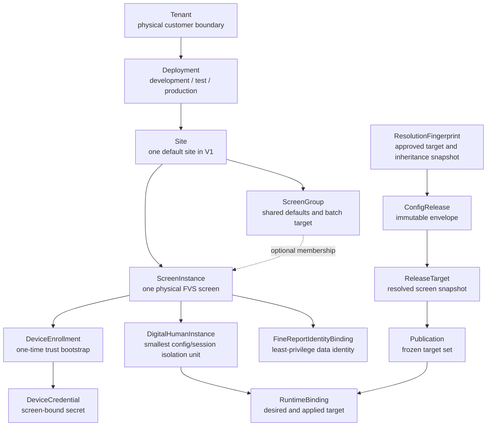

# P1 Target Domain Model

## Document Status

- Lifecycle: `TARGET_NOT_IMPLEMENTED`
- Scope: P1 control-plane aggregates, ownership and three-screen isolation
- Contract version: `p1.0-target-v1`
- Last reviewed: 2026-07-27

This is a target contract. The current runtime remains the single-instance POC.

## Identifier And Time Rules

- Persistent identifiers are server-generated UUIDv7 values rendered as lowercase canonical strings.
- Human-readable `slug` values are separate from identifiers and are unique only inside the parent named by this contract.
- Every tenant-owned row carries `tenant_id`; every cross-row reference is checked against the same tenant and deployment.
- Timestamps are UTC RFC 3339 values. Site-local time is display and scheduling metadata, never the stored ordering source.
- Mutable resources carry a monotonically increasing `resource_revision` and a strong ETag.
- Immutable records carry a content SHA-256 and never expose update or delete operations.

## Business-Readable Model

## Aggregate Ownership

| Aggregate | Parent / boundary | Mutable part | Immutable or append-only part |
| --- | --- | --- | --- |
| Tenant | Physical deployment | display metadata and status | tenant ID |
| Deployment | Tenant | environment metadata | deployment ID and tenant ownership |
| Site | Deployment | name, timezone, status | ownership lineage |
| ScreenGroup | Site | name, defaults, membership revision | historical publication target snapshots |
| ScreenInstance | Site | display name, group, FVS metadata reference, lifecycle | screen ID and enrollment history |
| DeviceEnrollment | ScreenInstance | only legal state transition | token digest, issuance and consumption evidence |
| DeviceCredential | ScreenInstance | only legal state transition | credential lineage, version and revocation evidence |
| DigitalHumanInstance | ScreenInstance | status and selected profile references | instance ID and screen ownership |
| FineReportIdentityBinding | ScreenInstance | metadata and `secret_ref` replacement | audit history; never the Secret value |
| FineReportIdentityBindingVersion / SecretVersion | owning binding / SecretRecord | none | immutable connector/Secret-version metadata; never plaintext |
| ConfigDraft | Tenant + Deployment | draft content only in `DRAFT` | validated revisions, findings and approvals |
| ConfigLayerRevision | one inheritance owner | none | immutable canonical layer patch, revision and content hash |
| ResolutionFingerprint | validated ConfigDraftRevision | none | target-set hash, source revisions and per-screen effective hashes bound to preview and approval |
| ConfigRelease | Tenant + Deployment | none after creation | release envelope, lineage and sequence |
| ReleaseTarget | ConfigRelease + ScreenInstance | none after creation | canonical effective screen content and hash |
| Publication | ConfigRelease + frozen screen targets | per-target operation state | original target set, request and actor |
| RuntimeBinding | ScreenInstance | desired/applied pointers via guarded transactions | binding history and device acknowledgements |
| HighRiskAction | Tenant + Deployment | legal approval transition only | normalized command hash, initiator, different approver and one-time consumption |
| RecoverySecurityLedger | independent recovery trust domain | append only | anchored user/device security epochs and chain heads |
| SecurityAuditEvent | Tenant + Deployment | none | append-only, hash-chained event |

## Core Objects

### Tenant, Deployment And Site

V1 is physically isolated per customer and normally has one Site. `tenant_id`, `deployment_id` and `site_id` remain explicit so that a future topology change does not require redefining ScreenInstance ownership. A request cannot select a different tenant through a header, query or body field.

### ScreenGroup

A group is a convenience for defaults and batch operations, not an authorization boundary. Draft validation resolves and freezes:

- the group `resource_revision`;
- the resolved ordered list of `screen_id` values;
- a SHA-256 target-set hash;
- every inheritance-layer revision and each screen's effective-content hash.

Preview and approval bind that ResolutionFingerprint. Release creation re-resolves it and fails with `RESOLUTION_FINGERPRINT_STALE` if membership or any source revision changed. Publication later uses the already-created ReleaseTargets and separately compares current group and RuntimeBinding preconditions; it never creates release content.

### ScreenInstance

ScreenInstance is the physical-screen inventory record. It owns DeviceEnrollment, DeviceCredential, DigitalHumanInstance, FineReportIdentityBinding and RuntimeBinding. A screen belongs to exactly one Site and at most one active ScreenGroup.

V1 permits at most one active DigitalHumanInstance per screen. Candidate instances may exist, but a RuntimeBinding selects exactly one active instance.

### RuntimeBinding

RuntimeBinding is one row per screen and separates control-plane intent from device confirmation:

| Field | Meaning |
| --- | --- |
| `desired_release_target_id` | resolved target the control plane wants this screen to apply |
| `applied_release_target_id` | resolved target last acknowledged by the authenticated device |
| `digital_human_instance_id` | active instance owned by the same screen |
| `binding_generation` | monotonically increasing compare-and-swap generation |
| `last_acknowledged_at` | latest successful device acknowledgement |

Publishing changes only the targeted screen's desired release. An offline device continues using its last applied, verified release. “Published by the control plane” and “applied by the device” are never treated as the same fact.

### ConfigDraft, ConfigRelease And Publication

- ConfigDraft is a mutable proposal with revision-bound validation, preview and approval evidence.
- ConfigLayerRevision is the immutable versioned input at each product-default, tenant, deployment, site, group and screen layer.
- ResolutionFingerprint is the immutable validation result containing the exact target-set hash, ConfigLayerRevision IDs/hashes, FineReport binding/Secret versions and per-screen effective hashes. Preview and approval bind its hash.
- ConfigRelease is created from one approved draft revision only after the same fingerprint is revalidated. The ConfigRelease and all ReleaseTargets are created atomically and are immutable.
- ReleaseTarget is the fully resolved immutable configuration and hash for exactly one screen. Publication can only reference an existing target belonging to its release and screen.
- Publication applies matching ReleaseTargets to an explicit frozen target set and stores a separate result per screen.
- Rollback copies a selected historical release into a new ConfigRelease with new lineage, then creates a new Publication. It never edits an earlier release or binding history.

## Boundary Invariants

| ID | Invariant |
| --- | --- |
| DM-01 | Every tenant-owned reference resolves inside the authenticated tenant and deployment. A cross-boundary lookup returns not found. |
| DM-02 | Device scope is derived from a valid DeviceCredential; device bodies cannot assert tenant, deployment, site or screen identity. |
| DM-03 | Control-plane AuthSession, DeviceCredential and FineReportIdentityBinding use different credential types and stores. |
| DM-04 | A DigitalHumanInstance, FineReportIdentityBinding and RuntimeBinding must reference the same ScreenInstance. |
| DM-05 | A ScreenInstance has one RuntimeBinding and no more than one active DigitalHumanInstance. |
| DM-06 | ConfigRelease and ReleaseTarget content, schema version, content hash and lineage cannot change after creation. |
| DM-07 | Publication target membership is frozen before any RuntimeBinding changes. |
| DM-08 | A target update uses the target's expected binding generation; one conflict cannot retarget another screen. |
| DM-09 | Rollback creates a new release, target and publication; no historical release or audit event is overwritten. |
| DM-10 | Secret values never appear in configuration documents, runtime bindings, audit details or backup manifests; only `secret_ref` may appear. |
| DM-11 | Authorization is checked by operation and resource scope for every API request, independently of UI visibility. |
| DM-12 | No delete cascade may remove ConfigRelease, Publication, device-revocation or SecurityAuditEvent evidence. |
| DM-13 | Preview, approval, ConfigRelease and ReleaseTarget creation bind one unchanged ResolutionFingerprint; stale membership or inheritance requires a new draft revision and approval. |
| DM-14 | PublicationTarget has a composite foreign key proving that its ReleaseTarget belongs to the Publication's release and the same ScreenInstance. |
| DM-15 | Production high-risk execution consumes an approved HighRiskAction whose initiator, different approver, target operation and normalized request hash match exactly. |

## Three-Screen Reference Walkthrough

The P1 contract fixture contains one Site and three screens:

| Screen | DigitalHumanInstance | Initial applied release | Target operation |
| --- | --- | --- | --- |
| screen 1 | human 1 | release A | unchanged |
| screen 2 | human 2 | release B | publish release D |
| screen 3 | human 3 | release C | unchanged |

The publication contains only screen 2 and its expected binding generation. Success changes screen 2's desired release to D. Screen 1 remains on A and screen 3 remains on C. Device acknowledgement later changes only screen 2's applied release. Any other change is a cross-screen leak and immediately fails P1.

## Deferred Detail

Provider-specific configuration, QuerySource, ScreenActionPackVersion, AvatarPackage and full capability schemas are referenced by version but specified in later result batches. Deferring their internal fields does not relax the ownership, Secret, immutability or screen-isolation rules in this contract.
