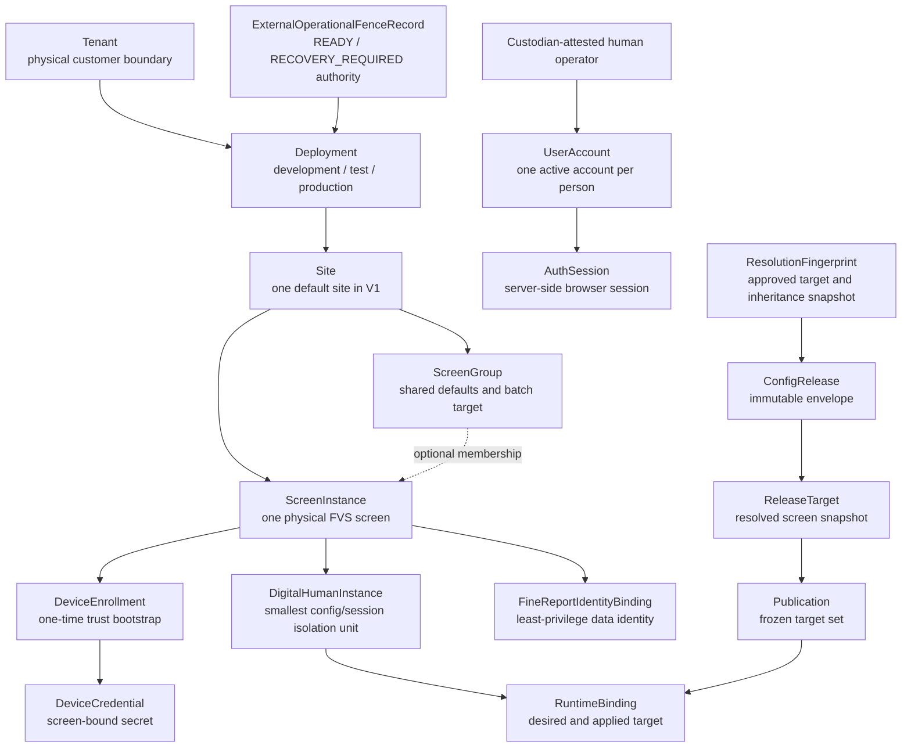

# P1 Target Domain Model

## Document Status

- Lifecycle: `TARGET_NOT_IMPLEMENTED`
- Scope: P1 control-plane aggregates, ownership and three-screen isolation
- Contract version: `p1.0-target-v1`
- Last reviewed: 2026-07-27

This is a target contract. The current runtime remains the single-instance POC.

## Identifier And Time Rules

- Persistent identifiers are server-generated UUIDv7 values rendered as lowercase canonical strings.
- Human-readable `slug` values are separate from identifiers and are unique only inside the parent named by this contract.
- Every tenant-owned row carries `tenant_id`; every cross-row reference is checked against the same tenant and deployment.
- Timestamps are UTC RFC 3339 values. Site-local time is display and scheduling metadata, never the stored ordering source.
- Mutable resources carry a monotonically increasing `resource_revision` and a strong ETag.
- Immutable records carry a content SHA-256 and never expose update or delete operations.

## Business-Readable Model

## Aggregate Ownership

| Aggregate | Parent / boundary | Mutable part | Immutable or append-only part |
| --- | --- | --- | --- |
| Tenant | Physical deployment | display metadata and status | tenant ID |
| Deployment | Tenant | irreversible `SETUP -> PRODUCTION_ACTIVE`, effective `READY | RECOVERY_REQUIRED` posture and readiness snapshot | deployment ID, tenant ownership, ledger evidence and highest verified external fence generation |
| Site | Deployment | name, timezone, status | ownership lineage |
| ScreenGroup | Site | name, defaults, membership revision | historical publication target snapshots |
| ScreenInstance | Site | display name, group, FVS metadata reference, lifecycle | screen ID and enrollment history |
| DeviceEnrollment | ScreenInstance | only legal state transition | token digest, issuance and consumption evidence |
| DeviceCredentialFamily | ScreenInstance | ledger-backed active version/state/generations | family lineage, revocation evidence and strong ETag |
| DeviceCredential | ScreenInstance | only legal state transition | credential lineage, version and revocation evidence |
| DigitalHumanInstance | ScreenInstance | status and selected profile references | instance ID and screen ownership |
| FineReportIdentityBinding | ScreenInstance | metadata and ledger-backed current-version/security generation | immutable version history; never the Secret value |
| FineReportIdentityBindingVersion / SecretVersion | owning binding / SecretRecord | none | immutable connector/Secret-version metadata; never plaintext |
| ConfigDraft | Tenant + Deployment | draft content only in `DRAFT` | validated revisions, findings and approvals |
| ConfigLayerRevision | one inheritance owner | none | immutable canonical layer patch, revision and content hash |
| ResolutionFingerprint | validated ConfigDraftRevision | none | target-set hash, source revisions and per-screen effective hashes bound to preview and approval |
| ConfigRelease | Tenant + Deployment | none after creation | release envelope, lineage and sequence |
| ReleaseTarget | ConfigRelease + ScreenInstance | none after creation | canonical effective screen content and hash |
| Publication | ConfigRelease + frozen screen targets | per-target operation state | original target set, request and actor |
| RuntimeBinding | ScreenInstance | desired/applied pointers via guarded transactions | binding history and device acknowledgements |
| HighRiskAction | Tenant + Deployment | legal state transition only | normalized command hash, initiator and one-time consumption |
| HighRiskApproval | HighRiskAction | none | append-only different-user decision, expected hash and reauthentication evidence |
| HumanOperatorIdentityAttestation / HumanOperatorUserBinding | external custodian-attested registry + UserAccount | monotonic eligibility/binding generations and revocation | Ed25519 2-of-3 evidence, exact person/user/target-possession binding and registry generations |
| DisasterRecoveryAuthorizationEnvelope | external local-recovery trust domain | none | signed entry condition, recovery-source/missing-subject set, custodian registry/signatures and nonce |
| RecoveryPasswordSetupGrant | standard restore, disaster restore or production-readiness authority transition + selected admin | provisional state only before branch-specific authority commit | digest/key ID, authorization kind, person/generation/stage binding, staged proof, terminal nonce and commit-anchor evidence |
| ExternalOperationalFenceRecord | external monotonic WORM/CAS anchor | append-only READY/RECOVERY_REQUIRED successors | HMAC/key ID, transition authorization, readiness facts, ledger/nonce/audit/final-result bindings |
| Readiness / emergency-reduction / crypto-root local recovery records | local-maintenance trust domain | nonce and authorization legal transitions only | 2-of-3 offline signatures, exact remediation/revocation/replacement plan and separate external audit evidence |
| ImmutableTypedCommand / AsyncOperation / Outbox / Idempotency | one executable authorization evidence | legal execution/delivery state only | shared authorization kind, exactly-one evidence ID and frozen exact command |
| RestoreContinuityEnvelope / RestoreCutoverRecord | RestorePlan + external ledger/anchor | legal cutover state only | source mode, authorization evidence, HMAC/key IDs, nonce and pointer evidence |
| ExternalKeyRegistry | external keystore + monotonic anchor | anchored key lifecycle | purpose, key ID/version/state and registry generation; never key material |
| RecoverySecurityLedger | independent recovery trust domain | append only | anchored user/device/authorization/Secret/FineReport security state and chain heads |
| SecurityAuditEvent | Tenant + Deployment | none | append-only, hash-chained event |

## Core Objects

### Tenant, Deployment And Site

V1 is physically isolated per customer and normally has one Site. `tenant_id`, `deployment_id` and `site_id` remain explicit so that a future topology change does not require redefining ScreenInstance ownership. A request cannot select a different tenant through a header, query or body field.

Deployment mode and operational posture are separate. `SETUP -> PRODUCTION_ACTIVE` is a one-way ledger-backed transition. In production, the highest verified `ExternalOperationalFenceRecord` is authoritative for `READY | RECOVERY_REQUIRED`; database/ledger posture is reconciled evidence, not a more privileged fallback. Temporary registry, anchor, key or dependency unavailability creates an ephemeral fail-closed 503 gate with persisted posture/domain state unchanged and clears automatically when the dependency recovers. Confirmed loss, revocation, invalid evidence or persistent readiness breach appends `RECOVERY_REQUIRED`.

Only local `recoverProductionReadiness` can append an authenticated READY successor after 2-of-3 offline authorization, a terminal readiness nonce, complete readiness recheck, ledger commit and `ExternalProductionReadinessRecoveryAudit`. `emergencyReduceAuthority` can only revoke/disable/reduce authority, writes an append-only external subject-generation tombstone and remains fenced. `recoverCryptographicReadinessRoot` may replace only the four named readiness/fence/disaster nonce HMAC roots, writes `ExternalCryptographicRootRecoveryAudit`, cannot write READY or mutate users/business state, and must be followed by a fresh normal readiness recovery.

### ScreenGroup

A group is a convenience for defaults and batch operations, not an authorization boundary. Draft validation resolves and freezes:

- the group `resource_revision`;
- the resolved ordered list of `screen_id` values;
- a SHA-256 target-set hash;
- every inheritance-layer revision and each screen's effective-content hash.

Preview and approval bind that ResolutionFingerprint. Release creation re-resolves it and fails with `RESOLUTION_FINGERPRINT_STALE` if membership or any source revision changed. Publication later uses the already-created ReleaseTargets and separately compares current group and RuntimeBinding preconditions; it never creates release content.

### ScreenInstance

ScreenInstance is the physical-screen inventory record. It owns DeviceEnrollment, DeviceCredential, DigitalHumanInstance, FineReportIdentityBinding and RuntimeBinding. A screen belongs to exactly one Site and at most one active ScreenGroup.

V1 permits at most one active DigitalHumanInstance per screen. Candidate instances may exist, but a RuntimeBinding selects exactly one active instance.

### RuntimeBinding

RuntimeBinding is one row per screen and separates control-plane intent from device confirmation:

| Field | Meaning |
| --- | --- |
| `desired_release_target_id` | resolved target the control plane wants this screen to apply |
| `applied_release_target_id` | resolved target last acknowledged by the authenticated device |
| `digital_human_instance_id` | active instance owned by the same screen |
| `binding_generation` | monotonically increasing compare-and-swap generation |
| `last_acknowledged_marker` | stable evidence marker for the exact target, generation and hash last acknowledged |
| `last_acknowledged_at` | latest successful device acknowledgement |

Publishing changes only the targeted screen's desired release and binding generation. Its DigitalHumanInstance, applied release and acknowledgement marker remain unchanged until their own authorized transitions. An offline device continues using its last applied, verified release. “Published by the control plane” and “applied by the device” are never treated as the same fact.

### ConfigDraft, ConfigRelease And Publication

- ConfigDraft is a mutable proposal with revision-bound validation, preview and approval evidence. Creation accepts only its target envelope and `schema_version`, initializes an empty spec and rejects initial content; `replaceConfigDraftSpec` is the sole initial-population path.
- ConfigLayerRevision is the immutable versioned input at each product-default, tenant, deployment, site, group and screen layer.
- ResolutionFingerprint is the immutable validation result containing the exact target-set hash, ConfigLayerRevision IDs/hashes, FineReport binding/Secret versions and per-screen effective hashes. Preview and approval bind its hash.
- A `NORMAL` ConfigRelease is created from one approved draft revision only after the same fingerprint is revalidated. A `ROLLBACK` ConfigRelease instead binds an immutable historical source-target map, target-set hash, exact versions and an approved HighRiskAction. The two provenance branches are mutually exclusive; either kind creates the ConfigRelease and all ReleaseTargets atomically and immutably.
- ReleaseTarget is the fully resolved immutable configuration and hash for exactly one screen. Publication can only reference an existing target belonging to its release and screen.
- Publication applies matching ReleaseTargets to an explicit frozen target set and stores a separate result per screen.
- Rollback copies a selected historical release into a new ConfigRelease with new lineage, then creates a new Publication. It never edits an earlier release or binding history.

## Boundary Invariants

| ID | Invariant |
| --- | --- |
| DM-01 | Every tenant-owned reference resolves inside the authenticated tenant and deployment. A cross-boundary lookup returns not found. |
| DM-02 | Device scope is derived from a valid DeviceCredential; device bodies cannot assert tenant, deployment, site or screen identity. |
| DM-03 | Control-plane AuthSession, DeviceCredential and FineReportIdentityBinding use different credential types and stores. |
| DM-04 | A DigitalHumanInstance, FineReportIdentityBinding and RuntimeBinding must reference the same ScreenInstance. |
| DM-05 | A ScreenInstance has one RuntimeBinding and no more than one active DigitalHumanInstance. |
| DM-06 | ConfigRelease and ReleaseTarget content, schema version, content hash and lineage cannot change after creation. |
| DM-07 | Publication target membership is frozen before any RuntimeBinding changes. |
| DM-08 | A target update uses the target's expected binding generation; one conflict cannot retarget another screen. |
| DM-09 | Rollback creates a new release, target and publication; no historical release or audit event is overwritten. |
| DM-10 | Secret values never appear in configuration documents, runtime bindings, audit details or backup manifests; only `secret_ref` may appear. |
| DM-11 | Authorization is checked by operation and resource scope for every API request, independently of UI visibility. |
| DM-12 | No delete cascade may remove ConfigRelease, Publication, device-revocation or SecurityAuditEvent evidence. |
| DM-13 | Preview, approval and `NORMAL` ConfigRelease/ReleaseTarget creation bind one unchanged ResolutionFingerprint; stale membership or inheritance requires an explicit new draft revision and approval. |
| DM-14 | PublicationTarget has a composite foreign key proving that its ReleaseTarget belongs to the Publication's release and the same ScreenInstance. |
| DM-15 | Production approval only appends HighRiskApproval evidence. The original initiator's exact protected-endpoint resubmission atomically consumes the approved HighRiskAction with the domain effect or durable async enqueue. |
| DM-16 | A `ROLLBACK` ConfigRelease has no normal-draft provenance; it binds one immutable historical target map, target-set hash, exact permitted versions and the consumed rollback HighRiskAction. |
| DM-17 | Recovery uses the latest ledger-authoritative role/scope snapshot and Secret/FineReport generations; an older backup cannot restore removed authority or predecessor credentials. |
| DM-18 | Device hard revocation compares the DeviceCredentialFamily ETag, credential epoch and ledger head, revokes the family atomically and increments the epoch exactly once. |
| DM-19 | Restore invalidates unfinished actions and prior-epoch config approvals while carrying the current restore's own authorization/idempotency/audit evidence through an external authenticated envelope. |
| DM-20 | Each DeviceCredentialFamily has at most one `ACTIVE` DeviceCredential and at most one `PENDING_ACTIVATION` successor. |
| DM-21 | User creation and normalized-username/display-name changes are RecoverySecurityLedger mutations ordered `PREPARED -> database -> COMMITTED anchor`. |
| DM-22 | A HighRiskAction binds its HMAC-SHA-256 digest key ID; the key remains available through the last referencing action's terminal state and evidence-retention interval, and missing key fails closed. |
| DM-23 | Async execution atomically freezes ImmutableTypedCommand, FrozenPlan, domain intent, AsyncOperation and OutboxRecord; its worker never rereads mutable request state. |
| DM-24 | A retiring Secret/FineReport predecessor is usable only when its AEAD ledger record contains a canonical sorted exact-target set and matching hash; missing or invalid evidence denies all. |
| DM-25 | Restore serves no external traffic during cutover. The selected admin-readiness branch is exact: normal/no-replacement uses existing attested administrators; local disaster may replace exactly one missing production administrator or use the SETUP single-admin branch, and every required selected person authenticates against staged state before switch. |
| DM-26 | Online SecurityAuditSuffix carries complete canonical sanitized events through the maintenance-barrier live head; full loss instead carries an empty backup-head-to-backup-head suffix plus signed ExternalRecoveryAudit and never fabricates a live head. |
| DM-27 | Every three-screen and cutover decision check completes before pointer replacement; after anchor commitment recovery finalizes forward and does not claim transparent rollback. |
| DM-28 | Pointer replacement and its database mark are separate failure domains; actual-pointer plus authenticated RestoreCutoverRecord evidence determines idempotent recovery. `SETUP` remains unserved; restored production visibility additionally waits for applicable nonce/ledger anchors, `FINALIZED`, complete readiness and a matching authenticated READY fence successor. |
| DM-29 | Eighteen cryptographic purpose domains never reuse keys; immutable records bind key ID/version and rotate by purpose without rewriting evidence. AEAD is AES-256-GCM with nonce uniqueness per key and stored nonce/tag/key ID/AAD. |
| DM-30 | Standard HighRiskAction and local 2-of-3 DisasterRecoveryAuthorizationEnvelope are XOR restore authorizers. RecoveryPasswordSetupGrant uses the exact standard/disaster/readiness branch and count matrix; no branch may widen roles or enable an unrelated user. |
| DM-31 | Bootstrap may have one administrator only in `SETUP`; activation requires two distinct credential-usable administrators bound to two distinct current attested persons. Network product mutation cannot reduce either count below two; emergency local safety revocation may cross that floor only while the deployment stays fenced. |
| DM-32 | HighRiskAction execution resubmission requires initiator reauthentication no more than 10 minutes old; stale proof returns 403 and leaves the action approved until TTL. |
| DM-33 | STAGED Secret/FineReport actions bind the canonical retiring-target set hash and affected RuntimeBinding generations, which execution recomputes exactly. |
| DM-34 | Production DeviceEnrollment issuance uses four eyes and binds current DeviceCredentialFamily generation plus RecoverySecurityLedger head. |
| DM-35 | `activateDeploymentProduction` requires platform-admin-only `deployment.manage`, `production_four_eyes_v1`, the two-admin floor and complete disaster readiness, then anchors the one-way `SETUP -> PRODUCTION_ACTIVE` transition. |
| DM-36 | Every asynchronous network execution record binds `authorization_kind` plus exactly one DirectOperationAuthorization, normal-action or disaster-envelope branch; the direct branch is only for backup creation/verification. Idempotency scope is phase + kind + evidence + exact command. Local readiness/emergency/root operations bind their own typed authorization, terminal nonce and external evidence and never fabricate network approval evidence. |
| DM-37 | Normal authorization implies online restore; full loss implies local disaster quorum; local+online is allowed only when no credential-usable administrator can authenticate. RestoreCutoverRecord and continuity HMAC bind source mode. |
| DM-38 | Recovery grants are provisional under one authority-transition `PREPARED` sequence; only the authorization-kind-specific committed anchors move the complete set to `COMMITTED_CONSUMED`, and any abort destroys every provisional verifier and terminally consumes the applicable nonce. |
| DM-39 | Every restore deletes one-time response replay ciphertext; full-loss failure keeps staged state unserved, while online failure may retain the previous active pointer. |
| DM-40 | Browser state changes require exact allowed Origin. Cookie mutations require the session CSRF header except exact-Origin/no-store `refreshCsrfToken`, the only narrow bootstrap exception; `getCurrentAuthSession` is read-only and never rotates CSRF. |
| DM-41 | `listPendingHighRiskActions` filters each item by both `risk.approve` and its target operation permission/resource scope. |
| DM-42 | Bootstrap, activation/readiness/emergency/root recovery, human-operator identity/binding, user/password/role, device, Secret, FineReport and key-registry security mutations use the closed network-or-local operation-to-ledger mapping. |
| DM-43 | Every authenticatable control-plane human user has a current external person attestation and user binding; at most one active user maps to a person per deployment. Production high-risk initiator and approver differ by both user ID and person ID. |
| DM-44 | `createUser` creates only a disabled empty-role `PROVISIONING` account. Provisioning credential setup binds the target channel/challenge and can set only credential plus possession evidence; custodian-signed person/user binding precedes enable or role grant. |
| DM-45 | The external operational fence is authoritative. HMAC alone cannot authorize READY, cryptographic-root repair cannot write READY, and READY recovery binds offline authorization, terminal nonce, ledger head, complete readiness and external audit/finalized-result hashes. |

## Three-Screen Reference Walkthrough

The P1 contract fixture contains one Site and three screens:

| Screen | DigitalHumanInstance | Initial desired/applied | Generation | Ack marker | Target operation |
| --- | --- | --- | ---: | --- | --- |
| screen 1 | human 1 | A / A | 10 | `ack-A-10` | unchanged |
| screen 2 | human 2 | B / B | 17 | `ack-B-17` | publish release D |
| screen 3 | human 3 | C / C | 4 | `ack-C-4` | unchanged |

The publication contains only screen 2 and its expected binding generation. Success changes only its desired release to D and generation to 18; human 2, applied B and `ack-B-17` remain. Its authenticated acknowledgement later changes only applied B to D and the marker to `ack-D-18`. Every RuntimeBinding field for screens 1 and 3 remains unchanged. Any other change is a cross-screen leak and immediately fails P1.

## Deferred Detail

Provider-specific configuration, QuerySource, ScreenActionPackVersion, AvatarPackage and full capability schemas are referenced by version but specified in later result batches. Deferring their internal fields does not relax the ownership, Secret, immutability or screen-isolation rules in this contract.
