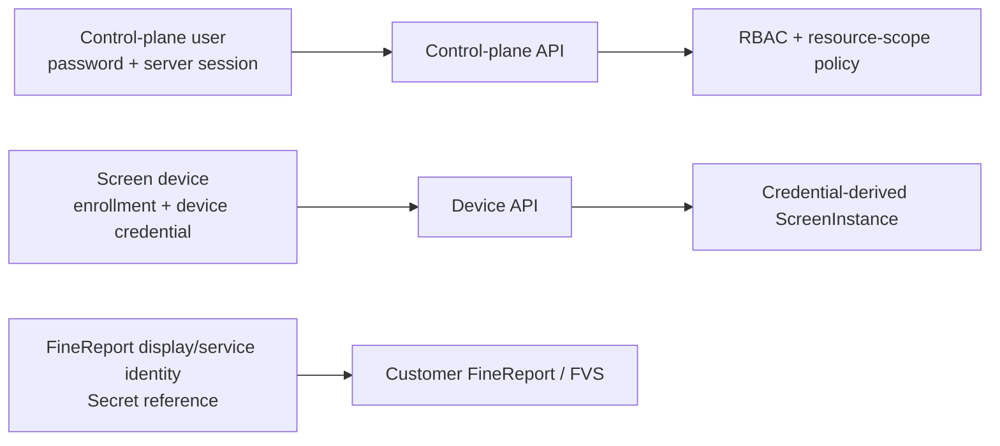

# P1 Target Identity And RBAC Contract

## Document Status

- Lifecycle: `TARGET_NOT_IMPLEMENTED`
- Scope: built-in local users, screen-device trust, FineReport identity and authorization
- Contract version: `p1.0-target-v1`
- Last reviewed: 2026-07-27

This is a security target for later P1 implementation. It does not describe the current POC administrator token.

## Three Separate Identity Planes

| Identity | Purpose | Credential | Scope source | Explicit prohibition |
| --- | --- | --- | --- | --- |
| Control-plane user | configure, publish, operate or audit | local password creates an opaque server-side session | authenticated UserAccount, roles and tenant/deployment membership | request bodies cannot name the operator |
| Screen device | retrieve and acknowledge one screen's binding | one-time enrollment followed by a versioned DeviceCredential | credential lookup determines tenant, deployment and screen | device requests cannot choose another screen |
| FineReport display / service identity | access only data authorized for one screen | customer-managed credential stored behind `secret_ref` | FineReportIdentityBinding owned by ScreenInstance | never reused as a product user or device credential |

No credential, session cookie, token table or rotation path is shared between these planes.

## Local User Policy

V1 uses built-in local accounts and RBAC. AD, LDAP, OIDC and MFA are outside V1; therefore the password is a single authentication factor and follows the stronger single-factor length baseline.

### Passwords

- Minimum length: 15 Unicode code points.
- Maximum accepted length: 128 Unicode code points; the full value is verified without truncation.
- Printing characters and spaces are accepted. No uppercase, lowercase, digit or symbol composition rule is imposed.
- Usernames, product defaults and a local blocklist of common or compromised passwords are rejected.
- Passwords do not expire periodically. A reset is required after evidence of compromise or an administrator security action.
- Storage uses Argon2id with a unique random salt. The implementation floor is 19 MiB memory, two iterations and parallelism one; a release may increase cost after reference-hardware calibration but cannot go below this floor.
- Plaintext passwords, reset tokens and password hashes never enter logs, audit details, support packages or backups in readable form.

The policy is aligned with [NIST SP 800-63B](https://pages.nist.gov/800-63-4/sp800-63b.html) password-verifier guidance and the [OWASP Password Storage Cheat Sheet](https://cheatsheetseries.owasp.org/cheatsheets/Password_Storage_Cheat_Sheet.html).

### Bootstrap

- Installation creates no shared default password.
- A local setup ceremony first reserves the server-selected first `user_id`, verifies the first external human-person attestation and first person-to-user binding with two distinct current custodians, and binds the target-controlled channel plus possession challenge. The resulting BootstrapGrant freezes those person, user, attestation, binding, channel, challenge and registry generations; none is client-selected at completion.
- A cryptographically random bootstrap secret of 256 bits is displayed once through that bound installation channel and expires after 30 minutes; only its keyed HMAC verifier and `verifier_key_id` persist, and replacement revokes the earlier grant.
- Only `completeBootstrap` accepts that secret and the first password. It cannot substitute a user, person, role, enabled state, attestation, binding or target channel, and it rechecks the current person eligibility, binding, possession, key and registry generations before commit.
- BootstrapGrant follows `ISSUED -> CONSUMED | EXPIRED | REVOKED`. Completion atomically creates exactly the grant-bound first person-backed platform administrator, invalidates every incomplete bootstrap grant and returns `Cache-Control: no-store`.
- Bootstrap completion leaves the deployment in `SETUP`. That state may temporarily contain exactly one credential-usable deployment-scoped platform administrator; it is not standard production and cannot claim the production safety guarantees below.

### Production Activation

Deployment mode follows the one-way state machine `SETUP -> PRODUCTION_ACTIVE`. `activateDeploymentProduction` requires `deployment.manage`, the `production_four_eyes_v1` typed HighRiskAction and a frozen complete machine-readiness snapshot. Among the mandatory facts are two credential-usable enabled deployment-scoped platform administrators backed by two distinct currently eligible attested persons; at least three active `OFFLINE_RECOVERY_AUTHENTICATION` custodians and three separately keyed `HUMAN_OPERATOR_ATTESTATION_SIGNATURE` custodians with successful signature preflights; healthy current person, key, ledger and monotonic-anchor registries; writable disaster, production-readiness and emergency-reduction nonce registries; OperationalFence compare-and-swap and trusted monotonic-time preflights; anchor-native cryptographic-root recovery preflight; the required backup root/key; and the RestoreContinuityEnvelope key. It binds the deployment ETag, current ledger head, registry generations and readiness hash, commits `deployment_production_activation`, and appends the initial authenticated `READY` OperationalFence record. Any missing check returns `409 PRODUCTION_READINESS_REQUIRED` and leaves mode `SETUP`.

### Login, Throttling And Lockout

- Login responses and response timing do not reveal whether an account exists, is disabled or is locked.
- Rate limits apply independently by account and source; changing source does not reset the account counter.
- Five failed attempts inside 15 minutes lock the account for 15 minutes.
- A repeated lock inside 24 hours increases the duration to 30 minutes and then 60 minutes; 60 minutes is the automatic-lock maximum.
- Successful authentication clears the rolling failure counter but not audit history.
- A platform administrator may unlock another account with a reason and recent reauthentication. Unlocking never changes the password.
- Authentication success, failure, throttling, lock, unlock and reset are append-only security events.

### Sessions

- Session IDs are opaque, unpredictable values with at least 256 bits of entropy. Only a keyed HMAC verifier and `verifier_key_id` are stored server-side.
- AuthSession follows `ACTIVE -> IDLE_EXPIRED | ABSOLUTE_EXPIRED | REVOKED`; every destination is terminal and cannot authenticate.
- Browser delivery uses `Secure`, `HttpOnly` and `SameSite=Strict` cookies; session IDs never appear in URLs or local storage.
- Each browser AuthSession has a CSRF token with at least 256 bits of entropy. It is bound to that session, rotated after authentication, reauthentication and every privilege change, and never appears in a URL, local storage or logs.
- The server stores only an HMAC-SHA-256 CSRF verifier and its `verifier_key_id`. `getCurrentAuthSession` is read-only: it never rotates or returns a plaintext CSRF token.
- `refreshCsrfToken` is the authenticated session-bootstrap operation. On an exact allowed `Origin`, it rotates and returns the plaintext only in `X-CSRF-Token` with `Cache-Control: no-store`; it is the unique cookie-authenticated mutation exempt from presenting the existing session-bound CSRF header.
- Every browser state-changing request, including unauthenticated login, requires an exact `Origin` from the server-configured allowlist. Every other cookie-authenticated mutation also requires the session-bound CSRF header. Only `GET`, `HEAD` and `OPTIONS` are safe-method exemptions; a missing/mismatched token or origin returns `403 FORBIDDEN`.
- Idle timeout: 30 minutes. Absolute timeout: 8 hours. Both are enforced server-side.
- The session ID is renewed after authentication, reauthentication and every privilege change.
- User disable, password reset and security-credential replacement revoke all sessions. Role changes advance an authorization epoch and commit an encrypted canonical role/resource-scope assignment snapshot, generation and hash to the RecoverySecurityLedger, so neither an old session nor an old backup can retain removed permissions.
- High-risk operations require password reauthentication no more than 10 minutes old plus a human-readable reason.
- `listOwnAuthSessions` and `revokeOwnAuthSession` let a user manage only sessions resolved from their own authenticated account. `listUserAuthSessions` and `revokeUserAuthSession` require `user.manage`; administrator termination requires recent reauthentication, reason and audit.

Idle and absolute expiry follow the [OWASP Session Management Cheat Sheet](https://cheatsheetseries.owasp.org/cheatsheets/Session_Management_Cheat_Sheet.html).

### Password Reset

- `issuePasswordReset` has exactly two issuance kinds. `NORMAL_PASSWORD_RESET` is restricted to an active, currently person-bound, non-privileged target and binds its person, user, role/scope, credential, eligibility, channel and possession-challenge generations. `PROVISIONING_CREDENTIAL_SETUP` is restricted to a disabled provisioning user with an empty role set; its person/binding fields are null while its target-controlled channel and possession challenge are required.
- A privileged target receives the non-retryable `FORBIDDEN` result and must use its own password-change path or authorized local offline recovery. The initiating administrator can neither set the password nor receive, retrieve or observe the token; plaintext is delivered only through the exact target-controlled one-time channel with `Cache-Control: no-store`.
- Each token has at least 256 random bits, expires after 15 minutes and persists only as a keyed HMAC verifier plus `verifier_key_id`. PasswordResetToken follows `ISSUED -> CONSUMED | EXPIRED | REVOKED`; `consumePasswordReset` atomically rechecks the complete issuance binding before accepting the token and new password.
- Normal reset revokes the target's outstanding reset tokens and AuthSessions and advances credential generation and authentication epoch. Provisioning consumption establishes only the credential and target-possession evidence: it never enables the user or grants a role, and a current two-custodian-signed person-to-user binding must exist before a later authorized enable or role grant.
- Offline restore and production-readiness password setup use the separately authorized RecoveryPasswordSetupGrant branches below. They never reveal an existing credential or allow their initiating custodians to observe the target's new credential.

Creating a user or changing `normalized_username` or `display_name` is an identity-security mutation: the service performs `append/fsync PREPARED`, commits the UserAccount and exact credential-free `user_identity_snapshot` with that sequence, then appends `COMMITTED` and advances the anchor. A retry cannot report success before that anchor is committed.

### Human Person And User Independence

Production human authority comes from the external monotonic custodian-attested person registry, not from a client-supplied UserAccount field. A person attestation requires two distinct current Ed25519 custodians under `HUMAN_OPERATOR_ATTESTATION_SIGNATURE`. A person-to-user binding separately requires two distinct current signatures under that purpose plus a server challenge and authenticated target-channel possession proof. All authenticatable human users require a current active person and binding; one person may have at most one active user in a deployment, and person identity fields are never client-assertable.

`createUser` creates only a disabled `PROVISIONING` user with an empty role set and accepts no password, enabled, role or person-binding fields. Target-only provisioning credential setup and the signed person-to-user binding precede any later enable or role grant. Every production authorization rechecks current person, binding, eligibility and revocation generations; restore uses the current external person registry, never the backup copy, and never widens eligibility.

A high-risk initiator and approver must differ in both `user_id` and `person_id`. Actions bind both persons' user, person-registry, binding, account, role/scope, credential and eligibility generations, and execution rechecks them. A relevant person, identity, binding, role or credential change invalidates affected `PENDING` or `APPROVED` actions; two accounts for one person can never satisfy four eyes.

### Restore And Readiness Password Setup Grants

Standard HighRiskAction authorization and DisasterRecoveryAuthorizationEnvelope are mutually exclusive. Normal authorization implies `ONLINE_ACTIVE_STORE`. `ACTIVE_STORE_UNAVAILABLE` requires full-loss/local disaster mode; `NO_CREDENTIAL_USABLE_ENABLED_DEPLOYMENT_PLATFORM_ADMIN` permits local disaster authorization against an online source. The envelope is local-maintenance-only, exposes no network API and substitutes solely for exact `executeRestorePlan`; every other high-risk operation keeps the normal policy.

The envelope requires two distinct Ed25519 signatures from at least three registered active custodians, expires after 30 minutes and has a single-use externally reserved nonce. It binds the exact entry condition/evidence, deployment mode and posture, recovery-source mode, deployment and staged-store IDs, backup-manifest hash, RecoverySecurityLedger head, completion mode, missing-credential subject set, selected admin user/person tuples and generations, person/custodian registries, nonce and expiry. In `SETUP`, local disaster restore selects one existing attested administrator and issues one grant. In `PRODUCTION_ACTIVE`, it selects two distinct attested-person administrators and issues two grants: normally two existing administrators, or—only when exactly one current active attested administrator survives—the `LOCAL_DISASTER_REPLACE_ONE` branch with one exact signed replacement, two offline-recovery signatures and two separate human-attestation signatures. Zero surviving administrators requires explicit reinitialization.

RecoveryPasswordSetupGrant supports exactly `STANDARD_HIGH_RISK`, `DISASTER_CUSTODIAN` and `PRODUCTION_READINESS_CUSTODIAN`, with exactly one matching authorization reference. Standard online restore issues exactly the number of grants needed for stale or missing selected-admin credentials, minimum one and maximum two; disaster restore uses the deployment-mode counts above; production-readiness `ADMIN_REPLACEMENT` issues exactly one. Every grant has at least 256 random bits and persists only as a keyed digest plus verifier key ID bound to its authority, target user/person and generations, credential stage, prepared sequence, nonce and expiry. Plaintext is target-local, one-time and `no-store`, and never enters continuity, ledger, audit, backup or logs.

The state machine is `ISSUED -> PROVISIONALLY_CONSUMED -> COMMITTED_CONSUMED`, with terminal alternatives `EXPIRED` and `ABORTED_REVOKED`. Provisional consumption creates the staged verifier and selected-person authentication proof against the same authority `PREPARED` sequence. Commit requires the matching branch anchor: restore ledger anchor for `STANDARD_HIGH_RISK`; restore ledger plus disaster-nonce anchors for `DISASTER_CUSTODIAN`; or production-readiness ledger, nonce and authenticated `READY` fence-successor anchors for `PRODUCTION_READINESS_CUSTODIAN`. Any required grant expiry, revocation or authentication failure atomically aborts the complete grant set, destroys all provisional verifiers and terminally consumes the applicable external nonce. Ordinary restore grants cannot enable a user, assign/widen a role or reactivate an old credential; only the exact signed one-admin replacement branches may create, bind, enable and grant the one named replacement while keeping every other authority increase forbidden.

Every `PRODUCTION_ACTIVE` restore finalization sets or keeps the authoritative OperationalFence at `RECOVERY_REQUIRED` bound to that finalized result; restore never reopens production itself. External serving requires a separate fresh local `recoverProductionReadiness` authorization and nonce, complete readiness, ExternalProductionReadinessRecoveryAudit, and a matching authenticated `READY_RECOVERY_SUCCESSOR`. A `SETUP` restore remains `SETUP` and non-serving until later production activation.

## Device Trust

### Enrollment

- An implementation engineer issues a 256-bit one-time enrollment secret for one ScreenInstance through production four-eyes approval bound to the current DeviceCredentialFamily generation and RecoverySecurityLedger head.
- The plaintext is returned with `Cache-Control: no-store`; the same idempotency key/request may recover it only through the five-minute encrypted one-time response record, while the enrollment record stores only its keyed HMAC verifier and `verifier_key_id`.
- The secret expires after 15 minutes and is consumed atomically.
- Claiming the secret binds the caller to the preselected screen and returns one DeviceCredential once. The claim body cannot contain tenant, deployment, site or screen IDs.

### Device Credential

- A DeviceCredential contains an opaque credential ID plus at least 256 random secret bits; only its keyed HMAC verifier and `verifier_key_id` are stored.
- Every authenticated device request resolves tenant, deployment and screen from the credential record.
- Rotation creates a successor credential version. First successful use of the successor atomically activates it and revokes the predecessor; an unactivated successor expires after 10 minutes.
- Enrollment claim and device rotation one-time credential responses use the same five-minute AEAD exact-replay limit; login never does, and restore deletes all replay ciphertext.
- A DeviceCredentialFamily has at most one `ACTIVE` DeviceCredential and at most one `PENDING_ACTIVATION` successor at any time.
- Administrative hard revocation immediately revokes the credential family and all device sessions for that screen.
- A revoked, expired or superseded credential always fails, even if an earlier request or cache contained it.
- Re-enrollment after hard revocation requires a new one-time enrollment issued by an authorized user.

## FineReport Identity

- A production ScreenInstance binds one least-privilege FineReport display / service identity or approved session strategy.
- The binding stores non-secret metadata plus `secret_ref`; it never stores a DSN, password, token or cookie in configuration JSON.
- Permission denial from FineReport is final. It cannot fall back to a database, Excel file or other identity with broader access.
- A sanitized binding read requires both `screen.read` and `secret.metadata.read`; it returns no Secret value, DSN, password, token or cookie.
- Replacing the binding is a dedicated high-risk operation requiring all of `screen.manage`, `secret.write` and `finereport.binding.manage`, recent reauthentication, reason, a different production approver and audit.
- Product user roles never imply FineReport data permission. The screen binding remains the data-access subject.

## Permission Catalog

| Permission | Protected action |
| --- | --- |
| `deployment.manage` | activate a fully ready deployment from `SETUP` to `PRODUCTION_ACTIVE`; platform administrator only |
| `user.manage` | create, update, enable, disable, unlock and reset local users; list and revoke their sessions |
| `role.assign` | replace role assignments |
| `screen.read` | view Site, group, screen and binding metadata |
| `screen.manage` | create or edit group, screen and digital-human inventory |
| `device.enroll` | issue or cancel one-time enrollment |
| `device.revoke` | hard-revoke a device credential family |
| `config.read` | view drafts, releases, diffs and effective metadata |
| `config.edit_business` | edit persona, welcome and business-policy fields |
| `config.edit_technical` | edit FVS, instance and technical binding fields |
| `config.validate` | validate a specific draft revision |
| `config.preview` | create a revision-bound preview |
| `config.approve` | approve or reject a revision |
| `release.publish` | publish an approved release |
| `release.rollback` | create and publish an immutable rollback release |
| `secret.metadata.read` | view Secret name, type, owner and rotation date |
| `secret.write` | create or replace a Secret value without reading it back |
| `finereport.binding.manage` | select or replace the screen's FineReport identity binding; platform administrator only |
| `operation.read` | view asynchronous operation status |
| `backup.create` | create and verify a logical backup |
| `backup.restore` | validate and execute a restore plan |
| `risk.approve` | approve or reject another user's exact high-risk command |
| `audit.read` | view immutable security and change events |

There is no `secret.reveal` permission.

Role catalog `p1_roles_v1` permits only exact `DEPLOYMENT`, `SITE` and `SCREEN` assignment scopes inside the authenticated tenant/deployment. A grant covers its named resource and descendants only, never siblings or ancestors. `platform_admin` is deployment-only; implementation engineers may be deployment/site/screen scoped; business operators site/screen scoped; operations engineers deployment/site scoped; auditors deployment/site/screen scoped. Role replacement supplies the complete sorted set and binds the user ETag, assignment generation and RecoverySecurityLedger head. Unknown roles, scope types, owner IDs or catalog versions deny the whole request.

After `PRODUCTION_ACTIVE`, standard production continuously requires at least two credential-usable, enabled, deployment-scoped `platform_admin` users backed by two distinct active attested persons. Ordinary network/product user and role mutations reject any transaction that would reduce either floor below two. A fresh bootstrap may remain at one administrator only while mode is `SETUP`; production activation requires the second distinct person and every readiness check above. The local-only `emergencyReduceAuthority` safety path may cross the floor only to revoke or disable authority while the deployment remains fenced `RECOVERY_REQUIRED`; it can never enable an account, grant a role or reopen serving.

## Default Role-Action Matrix

Legend: `A` allowed, `S` allowed only for the role's scoped business fields, `-` denied.

| Action group | Platform admin | Implementation engineer | Business operator | Operations engineer | Auditor |
| --- | :---: | :---: | :---: | :---: | :---: |
| Activate a ready deployment | A | - | - | - | - |
| Users and role assignments | A | - | - | - | - |
| Read screens and configuration | A | A | A | A | A |
| Manage screens and devices | A | A | - | - | - |
| Revoke device credential | A | - | - | - | - |
| Edit business configuration | A | A | S | - | - |
| Edit technical configuration | A | A | - | - | - |
| Validate and preview | A | A | A | - | - |
| Approve production revision | A | - | - | - | - |
| Publish and rollback | A | A | - | - | - |
| Read Secret metadata | A | A | - | - | - |
| Write Secret value | A | - | - | - | - |
| Manage FineReport identity binding | A | - | - | - | - |
| Monitor operation status | A | A | A | A | A |
| Create backup | A | - | - | A | - |
| Validate / execute restore | A | - | - | - | - |
| Approve another user's high-risk action | A | - | - | - | - |
| Read audit events | A | - | - | A | A |

The exact `production_four_eyes_v1` protected-operation set is `activateDeploymentProduction`, `createUser`, `updateUser`, `disableUser`, `enableUser`, `unlockUser`, `issuePasswordReset`, `revokeUserAuthSession`, `replaceUserRoles`, `publishToScreen`, `publishToScreenGroup`, `rollbackScreen`, `rollbackScreenGroup`, `issueDeviceEnrollment`, `revokeDeviceEnrollment`, `revokeDeviceCredential`, `createSecret`, `rotateSecret`, `putFineReportIdentityBinding` and `executeRestorePlan`:

1. The allowlisted protected business endpoint validates the caller's underlying permission and typed request, then stores the target operation, resource, reason, initiator, 15-minute expiry, a normalized-command HMAC-SHA-256 digest and its `request_hmac_key_id`. The digest key is held outside the live store, logs and backups; execution verifies with the key ID bound to the action. An old key remains available until the last referencing action reaches a terminal state and its evidence-retention period ends. Temporary key-service unavailability returns 503 and leaves the action unchanged; confirmed revocation or permanent loss returns `409 REQUEST_DIGEST_KEY_EPOCH_CHANGED` and irreversibly fails the action. A Secret-bearing body is never persisted in action, idempotency or audit evidence. No generic free-form action-creation endpoint exists.
2. A different user with `risk.approve`, the underlying target-operation permission/scope and reauthentication no more than 10 minutes old approves or rejects it. Approval appends one HighRiskApproval record and changes only `PENDING -> APPROVED`; it does not execute or enqueue the command. Self-approval always fails.
3. The original initiator resubmits the same typed command to the same protected endpoint with `High-Risk-Action-ID` and reauthentication no more than 10 minutes old. The server recomputes the normalized command digest, rechecks both users' current authorization and all resource preconditions, then atomically consumes `APPROVED -> CONSUMED` with the synchronous domain write or, for asynchronous work, an ImmutableTypedCommand, FrozenPlan, domain intent, AsyncOperation and durable OutboxRecord. Stale initiator reauthentication returns HTTP 403 with code `RECENT_REAUTHENTICATION_REQUIRED`; it does not consume or fail the action, which remains `APPROVED` until its original TTL. The worker executes only frozen intent and never rereads or reparses mutable request state. An expired, reused, changed or mismatched action fails with no domain effect.
4. Development/test may use auto-approval only under an explicitly configured policy that creates equivalent immutable evidence. Production never auto-approves.

Every standard high-risk or disaster-restore executable command records `authorization_kind` and exactly one evidence ID: `high_risk_action_id` for standard authorization or `disaster_recovery_authorization_envelope_id` for local disaster restore. ImmutableTypedCommand, IdempotencyRecord, AsyncOperation, OutboxRecord and SecurityAuditEvent bind the same tuple; disaster mode never fabricates a user actor or HighRiskApproval. Execution idempotency is scoped by phase + authorization kind + evidence ID + exact command. A crash before the atomic commit leaves the standard action `APPROVED` and creates no effect. For a non-ledger-backed effect, a crash after commit returns the stored result without repeating the effect. For a ledger-backed effect left at `PREPARED`, retry must reconcile the domain commit, append `COMMITTED` and advance the external anchor before returning success; if reconciliation is unavailable, it fails closed with `503 SECURITY_LEDGER_RECONCILIATION_REQUIRED`. Failed reauthorization or precondition checks move a standard action to `FAILED` and create no effect. Local-only production-readiness, emergency-reduction and cryptographic-root recovery use their own typed offline authorization and external audit records rather than this action/envelope tuple.

Draft approval separately requires an approver different from the last content editor in the production preset and binds the current control-plane epoch. After restore advances that epoch, earlier approvals remain historical evidence but cannot create a release.

## Authorization Rules

1. Deny by default and check permission on every API request.
2. Resolve tenant and deployment from the authenticated principal, never a client-selected header.
3. Check the resource ownership chain after the operation permission.
4. Return `404 RESOURCE_NOT_FOUND` for nonexistent or cross-boundary resources to reduce enumeration.
5. Re-evaluate roles and resource scope for every request; the UI is not an authorization source.
6. Bind approval and reauthentication evidence to the exact actor, operation, resource revision, normalized HighRiskAction HMAC and `request_hmac_key_id`. General sensitive idempotency evidence uses its separate HMAC and `sensitive_digest_key_id`.
7. Record success and denial without logging the submitted Secret, password, token, DSN or complete sensitive request body.
8. `listPendingHighRiskActions` includes an item only when the viewer has both `risk.approve` and that item's target-operation permission/resource scope; unauthorized items are omitted rather than merely disabled in the UI.

These rules follow the deny-by-default and every-request checks in the [OWASP Authorization Cheat Sheet](https://cheatsheetseries.owasp.org/cheatsheets/Authorization_Cheat_Sheet.html).

## Secret Write Semantics

A dedicated Secret write request may contain a plaintext value over the protected transport. The service encrypts it immediately and returns only:

- `secret_ref`;
- display name and type;
- owner tenant / deployment metadata;
- created and rotation timestamps;
- non-sensitive fingerprint suffix.

Ordinary GET, list, audit, diff, export and support operations never return the value. Replacing a Secret creates an immutable SecretVersion, advances the SecretRecord security generation/current-version pointer and commits that non-secret authoritative state to the RecoverySecurityLedger. FineReport binding replacement likewise creates an immutable FineReportIdentityBindingVersion and advances a ledger-backed binding generation/current-version pointer.

The closed rotation modes are `STAGED` and `EMERGENCY_REVOKE`; `STAGED` is the default. The new version becomes `ACTIVE` and is the only version permitted for a new draft, release, publication, rollback or runtime delivery. The predecessor becomes `RETIRING` and may serve only the exact ReleaseTargets already applied at rotation time, for at most 24 hours. The canonical lexicographically sorted target-ID set and its hash are stored together inside the AEAD-protected ledger record; a missing set, hash mismatch or noncanonical order makes the predecessor deny all and enters recovery-required state. The Secret/FineReport HighRiskAction binds that exact set hash plus every affected RuntimeBinding generation. Execution recomputes the canonical set/hash and generations; any change returns `HIGH_RISK_ACTION_MISMATCH` with no effect. A valid predecessor cannot be newly delivered or rebound. `EMERGENCY_REVOKE` and retiring-window expiry make it `REVOKED` immediately; affected runtime fails closed until a new approved release uses the active version. Restore may preserve or narrow these ledger-authoritative usage states, never widen them. ReleaseTarget still binds exact versions, so rotation cannot silently change historical meaning; retained historical ciphertext is evidence/recovery material, not permission to reactivate a predecessor.

## Key Management Domains

Every protected record binds a key ID and version from exactly one purpose domain. The eighteen domains are `HIGH_RISK_REQUEST_HMAC`, `SENSITIVE_REQUEST_DIGEST_HMAC`, `RESTORE_CONTINUITY_ENVELOPE_HMAC`, `RECOVERY_LEDGER_CHAIN_HMAC`, `RECOVERY_LEDGER_RECORD_AEAD`, `AUTH_SESSION_VERIFIER_PEPPER`, `CSRF_TOKEN_VERIFIER_PEPPER`, `ONE_TIME_TOKEN_VERIFIER_PEPPER`, `ONE_TIME_RESPONSE_ENCRYPTION`, `DEVICE_CREDENTIAL_VERIFIER_PEPPER`, `SECRET_ENVELOPE_ENCRYPTION`, `BACKUP_RECOVERY_ENCRYPTION`, `OFFLINE_RECOVERY_AUTHENTICATION`, `HUMAN_OPERATOR_ATTESTATION_SIGNATURE`, `DISASTER_ENVELOPE_NONCE_HMAC`, `OPERATIONAL_FENCE_HMAC`, `PRODUCTION_READINESS_NONCE_HMAC` and `EMERGENCY_AUTHORITY_REDUCTION_NONCE_HMAC`. Cross-purpose reuse is forbidden. Symmetric service purposes have at most one `ACTIVE` key; offline recovery and human attestation each have at most one active purpose-specific key per custodian and at least three active custodians, and those two key sets remain distinct. New writes use the applicable active key and verification uses the record-bound key ID. Backup-recovery encryption, offline recovery authorization and human attestation always use distinct keys.

DirectOperationAuthorization stores `request_hmac_key_id` under `SENSITIVE_REQUEST_DIGEST_HMAC`; HighRiskAction stores its separate `request_hmac_key_id` under `HIGH_RISK_REQUEST_HMAC`. The identical field suffix does not permit cross-purpose verification or substitution.

Every keyed verifier uses HMAC-SHA-256 with a purpose-bound key of at least 256 bits and stores its `key_id`; this covers bootstrap, session/CSRF, reset, enrollment, setup-grant and device verifiers. Every AEAD record uses AES-256-GCM, guarantees nonce uniqueness per key and stores `nonce`, authentication `tag`, `key_id` and the canonical associated-data schema needed to bind ownership, record type/version and immutable context.

Key metadata contains `key_id`, purpose domain, version, `ACTIVE | VERIFY_ONLY | RETIRED | REVOKED`, created/activated time, verify-only deadline and retired/revoked time; key material itself never enters the live store, logs, backups or evidence. The authoritative registry and its monotonic generation live in the external keystore/anchor, rotation/revocation are ledger-backed and anchored, and restore uses that current registry rather than a backup copy. Immutable protected records are never rewritten merely for rotation: request/envelope HMAC and verifier artifacts retain their bound verification key for their reference lifetime; ledger-chain rotation appends a rotation record; ledger-record AEAD appends wrapped-DEK metadata or retains the decrypt key; one-time response keys live at most five minutes and restore deletes their ciphertext; Secret envelopes use successor versions or DEK rewrap without changing business-content hashes; and backup/offline keys rotate per bundle or custodian.

Temporary key-service unavailability returns `503 KEY_SERVICE_UNAVAILABLE` (or the purpose-specific 503) and leaves credential/action state unchanged. Only confirmed revocation or permanent loss performs irreversible invalidation. Such loss or compromise fails closed by purpose: verifier-key loss invalidates affected sessions, one-time tokens or device credentials; durable RecoverySecurityLedger chain/record key loss blocks security mutation and restore; request-HMAC compromise fails pending actions with a key-epoch change; ledger compromise freezes security mutation/restore for incident handling; session/token compromise advances affected authentication epochs; device-verifier compromise requires re-enrollment; Secret-envelope compromise requires Secret rotation; backup-key loss makes that backup unrecoverable until authorized key recovery; and offline-authorization compromise disables that custodian key and requires a fresh quorum.

## Draft Field Authorization

`replaceConfigDraftSpec` computes the canonical old/new leaf diff, normalizes every path as RFC 6901 JSON Pointer, then applies the most-specific exact or declared-subtree rule before writing. Every P1.0 registry entry below is explicitly `exact`; adding a subtree requires a future contract change:

| Field class | Required permission | Examples |
| --- | --- | --- |
| Business | `config.edit_business` | `/welcome_text`, `/persona`, `/business_policy` |
| Technical | `config.edit_technical` | `/fvs_binding_ref`, `/digital_human_instance_id`, `/capability_profile_ref`, `/technical_policy` |
| FineReport identity reference | all of `config.edit_technical`, `finereport.binding.manage` | `/fine_report_identity_ref` |

An unclassified field is denied. A mixed request requires every permission represented by every changed field; holding only one permission never authorizes the other fields. Authorization is atomic: one unauthorized change rejects the complete request without creating a revision, and no partial write is allowed. The reference in a draft is configuration metadata only—creating or replacing the underlying FineReportIdentityBinding still requires the dedicated joint-permission operation above.
