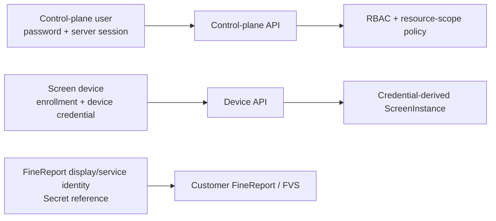

# P1 Target Identity And RBAC Contract

## Document Status

- Lifecycle: `TARGET_NOT_IMPLEMENTED`
- Scope: built-in local users, screen-device trust, FineReport identity and authorization
- Contract version: `p1.0-target-v1`
- Last reviewed: 2026-07-27

This is a security target for later P1 implementation. It does not describe the current POC administrator token.

## Three Separate Identity Planes

| Identity | Purpose | Credential | Scope source | Explicit prohibition |
| --- | --- | --- | --- | --- |
| Control-plane user | configure, publish, operate or audit | local password creates an opaque server-side session | authenticated UserAccount, roles and tenant/deployment membership | request bodies cannot name the operator |
| Screen device | retrieve and acknowledge one screen's binding | one-time enrollment followed by a versioned DeviceCredential | credential lookup determines tenant, deployment and screen | device requests cannot choose another screen |
| FineReport display / service identity | access only data authorized for one screen | customer-managed credential stored behind `secret_ref` | FineReportIdentityBinding owned by ScreenInstance | never reused as a product user or device credential |

No credential, session cookie, token table or rotation path is shared between these planes.

## Local User Policy

V1 uses built-in local accounts and RBAC. AD, LDAP, OIDC and MFA are outside V1; therefore the password is a single authentication factor and follows the stronger single-factor length baseline.

### Passwords

- Minimum length: 15 Unicode code points.
- Maximum accepted length: 128 Unicode code points; the full value is verified without truncation.
- Printing characters and spaces are accepted. No uppercase, lowercase, digit or symbol composition rule is imposed.
- Usernames, product defaults and a local blocklist of common or compromised passwords are rejected.
- Passwords do not expire periodically. A reset is required after evidence of compromise or an administrator security action.
- Storage uses Argon2id with a unique random salt. The implementation floor is 19 MiB memory, two iterations and parallelism one; a release may increase cost after reference-hardware calibration but cannot go below this floor.
- Plaintext passwords, reset tokens and password hashes never enter logs, audit details, support packages or backups in readable form.

The policy is aligned with [NIST SP 800-63B](https://pages.nist.gov/800-63-4/sp800-63b.html) password-verifier guidance and the [OWASP Password Storage Cheat Sheet](https://cheatsheetseries.owasp.org/cheatsheets/Password_Storage_Cheat_Sheet.html).

### Bootstrap

- Installation creates no shared default password.
- A cryptographically random bootstrap secret of 256 bits is displayed once through the installation channel and expires after 30 minutes; the installer may issue a replacement only after revoking the earlier grant.
- Only `completeBootstrap` accepts that secret. Its schema can set the first platform-administrator password and register the initial recovery-key reference; it cannot call any other API.
- BootstrapGrant follows `ISSUED -> CONSUMED | EXPIRED | REVOKED`. Completion atomically creates the first administrator, invalidates every incomplete bootstrap grant and returns `Cache-Control: no-store`.

### Login, Throttling And Lockout

- Login responses and response timing do not reveal whether an account exists, is disabled or is locked.
- Rate limits apply independently by account and source; changing source does not reset the account counter.
- Five failed attempts inside 15 minutes lock the account for 15 minutes.
- A repeated lock inside 24 hours increases the duration to 30 minutes and then 60 minutes; 60 minutes is the automatic-lock maximum.
- Successful authentication clears the rolling failure counter but not audit history.
- A platform administrator may unlock another account with a reason and recent reauthentication. Unlocking never changes the password.
- Authentication success, failure, throttling, lock, unlock and reset are append-only security events.

### Sessions

- Session IDs are opaque, unpredictable values with at least 256 bits of entropy. Only a keyed digest is stored server-side.
- AuthSession follows `ACTIVE -> IDLE_EXPIRED | ABSOLUTE_EXPIRED | REVOKED`; every destination is terminal and cannot authenticate.
- Browser delivery uses `Secure`, `HttpOnly` and `SameSite=Strict` cookies; session IDs never appear in URLs or local storage.
- Idle timeout: 30 minutes. Absolute timeout: 8 hours. Both are enforced server-side.
- The session ID is renewed after authentication and every privilege change.
- User disable, password reset and security-credential replacement revoke all sessions. Role changes advance an authorization epoch so old sessions cannot retain removed permissions.
- High-risk operations require password reauthentication no more than 10 minutes old plus a human-readable reason.
- `listOwnAuthSessions` and `revokeOwnAuthSession` let a user manage only sessions resolved from their own authenticated account. `listUserAuthSessions` and `revokeUserAuthSession` require `user.manage`; administrator termination requires recent reauthentication, reason and audit.

Idle and absolute expiry follow the [OWASP Session Management Cheat Sheet](https://cheatsheetseries.owasp.org/cheatsheets/Session_Management_Cheat_Sheet.html).

### Password Reset

- Reset initiation always returns the same safe response and every reset-token response uses `Cache-Control: no-store`.
- An administrator may issue a cryptographically random, at least 256-bit, single-use reset token that expires after 15 minutes; only its digest is stored.
- The administrator cannot set, retrieve or view the user's new password.
- PasswordResetToken follows `ISSUED -> CONSUMED | EXPIRED | REVOKED`. Only `consumePasswordReset` may submit the token and new password, and the token is consumed atomically with password replacement.
- Successful reset invalidates all outstanding reset tokens and AuthSessions for that user, increments both credential generation and authentication epoch, and requires a fresh login. It never enables a disabled user.
- Offline break-glass recovery requires host access and the separately held recovery key. It creates an immutable event at the next control-plane start and cannot reveal existing credentials.

## Device Trust

### Enrollment

- An implementation engineer issues a 256-bit one-time enrollment secret for one ScreenInstance.
- The plaintext is returned once with `Cache-Control: no-store`; only a keyed digest is persisted.
- The secret expires after 15 minutes and is consumed atomically.
- Claiming the secret binds the caller to the preselected screen and returns one DeviceCredential once. The claim body cannot contain tenant, deployment, site or screen IDs.

### Device Credential

- A DeviceCredential contains an opaque credential ID plus at least 256 random secret bits; only a keyed verifier is stored.
- Every authenticated device request resolves tenant, deployment and screen from the credential record.
- Rotation creates a successor credential version. First successful use of the successor atomically activates it and revokes the predecessor; an unactivated successor expires after 10 minutes.
- Administrative hard revocation immediately revokes the credential family and all device sessions for that screen.
- A revoked, expired or superseded credential always fails, even if an earlier request or cache contained it.
- Re-enrollment after hard revocation requires a new one-time enrollment issued by an authorized user.

## FineReport Identity

- A production ScreenInstance binds one least-privilege FineReport display / service identity or approved session strategy.
- The binding stores non-secret metadata plus `secret_ref`; it never stores a DSN, password, token or cookie in configuration JSON.
- Permission denial from FineReport is final. It cannot fall back to a database, Excel file or other identity with broader access.
- A sanitized binding read requires both `screen.read` and `secret.metadata.read`; it returns no Secret value, DSN, password, token or cookie.
- Replacing the binding is a dedicated high-risk operation requiring all of `screen.manage`, `secret.write` and `finereport.binding.manage`, recent reauthentication, reason, a different production approver and audit.
- Product user roles never imply FineReport data permission. The screen binding remains the data-access subject.

## Permission Catalog

| Permission | Protected action |
| --- | --- |
| `user.manage` | create, disable, unlock and reset local users |
| `role.assign` | replace role assignments |
| `screen.read` | view Site, group, screen and binding metadata |
| `screen.manage` | create or edit group, screen and digital-human inventory |
| `device.enroll` | issue or cancel one-time enrollment |
| `device.revoke` | hard-revoke a device credential family |
| `config.read` | view drafts, releases, diffs and effective metadata |
| `config.edit_business` | edit persona, welcome and business-policy fields |
| `config.edit_technical` | edit FVS, instance and technical binding fields |
| `config.validate` | validate a specific draft revision |
| `config.preview` | create a revision-bound preview |
| `config.approve` | approve or reject a revision |
| `release.publish` | publish an approved release |
| `release.rollback` | create and publish an immutable rollback release |
| `secret.metadata.read` | view Secret name, type, owner and rotation date |
| `secret.write` | create or replace a Secret value without reading it back |
| `finereport.binding.manage` | select or replace the screen's FineReport identity binding; platform administrator only |
| `operation.read` | view asynchronous operation status |
| `backup.create` | create and verify a logical backup |
| `backup.restore` | validate and execute a restore plan |
| `risk.approve` | approve or reject another user's exact high-risk command |
| `audit.read` | view immutable security and change events |

There is no `secret.reveal` permission.

## Default Role-Action Matrix

Legend: `A` allowed, `S` allowed only for the role's scoped business fields, `-` denied.

| Action group | Platform admin | Implementation engineer | Business operator | Operations engineer | Auditor |
| --- | :---: | :---: | :---: | :---: | :---: |
| Users and role assignments | A | - | - | - | - |
| Read screens and configuration | A | A | A | A | A |
| Manage screens and devices | A | A | - | - | - |
| Revoke device credential | A | - | - | - | - |
| Edit business configuration | A | A | S | - | - |
| Edit technical configuration | A | A | - | - | - |
| Validate and preview | A | A | A | - | - |
| Approve production revision | A | - | - | - | - |
| Publish and rollback | A | A | - | - | - |
| Read Secret metadata | A | A | - | - | - |
| Write Secret value | A | - | - | - | - |
| Manage FineReport identity binding | A | - | - | - | - |
| Monitor operation status | A | A | A | A | A |
| Create backup | A | - | - | A | - |
| Validate / execute restore | A | - | - | - | - |
| Approve another user's high-risk action | A | - | - | - | - |
| Read audit events | A | - | - | A | A |

The standard production preset requires four eyes for publication, rollback, device-credential revocation, Secret rotation/replacement, FineReport identity replacement and restore:

1. The allowlisted protected business endpoint validates the caller's underlying permission and typed request, then stores the target operation, resource, reason, initiator, 15-minute expiry and SHA-256 of the normalized command. No generic free-form action-creation endpoint exists.
2. A different user with `risk.approve`, the underlying target-operation permission/scope and reauthentication no more than 10 minutes old approves or rejects it. Self-approval always fails.
3. The protected operation must present that HighRiskAction. The server recomputes the normalized command hash and atomically consumes the approval with the domain effect; an expired, reused or mismatched approval fails.
4. Development/test may use auto-approval only under an explicitly configured policy that creates equivalent immutable evidence. Production never auto-approves.

Draft approval separately requires an approver different from the last content editor in the production preset.

## Authorization Rules

1. Deny by default and check permission on every API request.
2. Resolve tenant and deployment from the authenticated principal, never a client-selected header.
3. Check the resource ownership chain after the operation permission.
4. Return `404 RESOURCE_NOT_FOUND` for nonexistent or cross-boundary resources to reduce enumeration.
5. Re-evaluate roles and resource scope for every request; the UI is not an authorization source.
6. Bind approval, reauthentication and idempotency evidence to the exact actor, operation, resource revision and normalized request hash.
7. Record success and denial without logging the submitted Secret, password, token, DSN or complete sensitive request body.

These rules follow the deny-by-default and every-request checks in the [OWASP Authorization Cheat Sheet](https://cheatsheetseries.owasp.org/cheatsheets/Authorization_Cheat_Sheet.html).

## Secret Write Semantics

A dedicated Secret write request may contain a plaintext value over the protected transport. The service encrypts it immediately and returns only:

- `secret_ref`;
- display name and type;
- owner tenant / deployment metadata;
- created and rotation timestamps;
- non-sensitive fingerprint suffix.

Ordinary GET, list, audit, diff, export and support operations never return the value. Replacing a Secret creates an immutable SecretVersion and advances only the SecretRecord envelope pointer. FineReport binding replacement likewise creates an immutable FineReportIdentityBindingVersion. ReleaseTarget binds exact versions, so later rotation cannot change historical release meaning; historical ciphertext is retained only as required for immutable releases and encrypted recovery.

## Draft Field Authorization

`replaceConfigDraftSpec` computes the canonical old/new leaf diff, normalizes every path as RFC 6901 JSON Pointer, then applies the most-specific exact or declared-subtree rule before writing:

| Field class | Required permission | Examples |
| --- | --- | --- |
| Business | `config.edit_business` | `/welcome_text`, `/persona`, `/business_policy` |
| Technical | `config.edit_technical` | `/fvs_binding_ref`, `/digital_human_instance_id`, `/capability_profile_ref`, `/technical_policy` |
| FineReport identity reference | all of `config.edit_technical`, `finereport.binding.manage` | `/fine_report_identity_ref` |

An unclassified field is denied. A mixed request requires every permission represented by every changed field; holding only one permission never authorizes the other fields. Authorization is atomic: one unauthorized change rejects the complete request without creating a revision, and no partial write is allowed. The reference in a draft is configuration metadata only—creating or replacing the underlying FineReportIdentityBinding still requires the dedicated joint-permission operation above.
